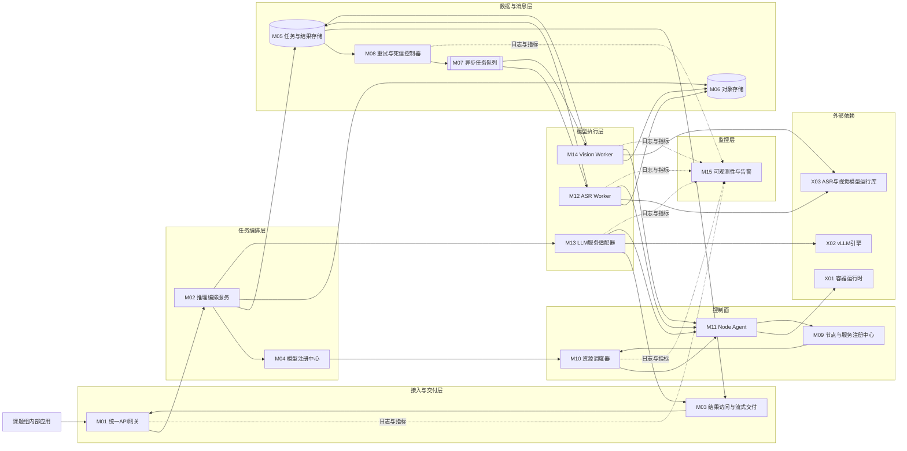
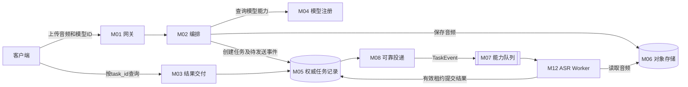
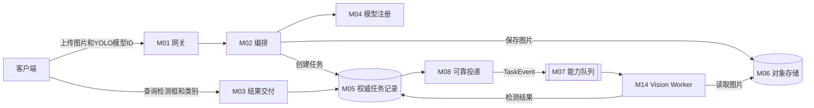
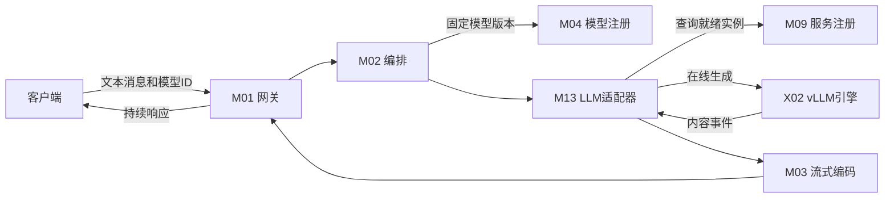
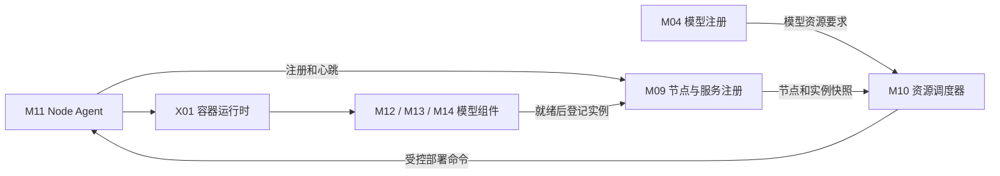
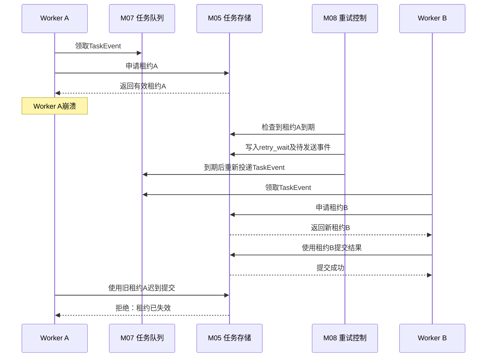
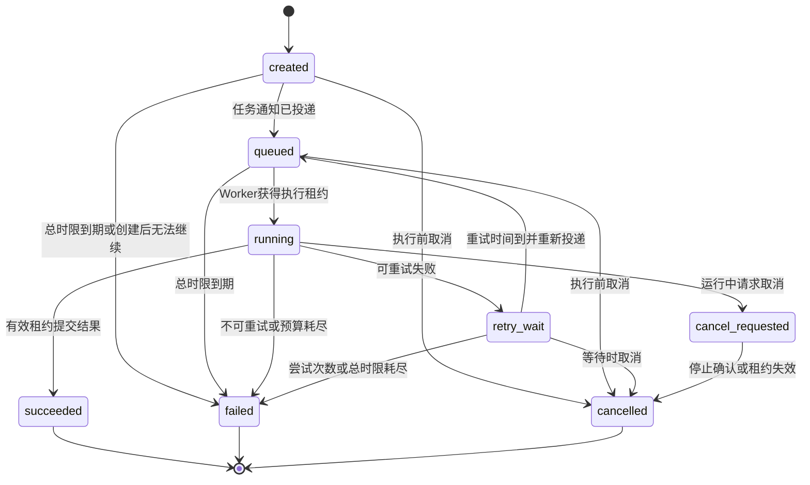

# 分布式通用AI推理与算力调度平台 业务架构与详细设计 v2.1

| 项目项 | 内容 |
|---|---|
| 版本 | v2.1 |
| 文档用途 | 提交陈老师和课题组师兄评审，并作为后续开发拆分与架构网页更新的共同依据 |
| 设计状态 | 初稿；所有模块和函数均为建议设计，尚未实现 |
| 适用范围 | 课题组内部的ASR、LLM、YOLO等自建模型推理与CPU/GPU算力管理 |
| 当前交付 | 完整业务架构、数据流、控制流、状态与资源规则、模块职责、主要函数、验收场景和开发拆分 |
| 后续交付 | 本文评审通过后，按照网页展示映射更新只读交互式架构网页 |

> 阅读说明：本文描述的是准备建设的平台，不代表当前仓库中已有这些模块、接口或函数。数据库、Redis Streams、MinIO、Docker和vLLM等均为候选技术或外部依赖；兼容性、GPU参数、取消行为和吞吐能力需结合实际代码、硬件和官方资料验证。

## 1. 项目概述

### 1.1 平台是什么

本项目面向课题组内部应用，计划建设一个统一的AI推理与算力调度平台。上层实验程序或业务系统通过统一入口提交推理请求，平台负责识别任务类型、选择指定模型的执行通道、管理任务状态，并协调模型服务与CPU/GPU算力。

平台首批覆盖三类模型：

- ASR（Automatic Speech Recognition，自动语音识别）负责把音频转换成文字，例如SenseVoice、Whisper和Fun-ASR-Nano。
- LLM（Large Language Model，大语言模型）负责根据文本上下文持续生成文本，首版考虑通过vLLM提供在线推理。
- YOLO是一类视觉目标检测模型，负责从图片中识别目标类别、位置和置信度。

ASR和YOLO首版采用异步任务：客户端上传文件后先取得任务ID，随后查询结果。LLM需要实时显示生成内容，首版采用在线流式请求，直接路由到已就绪的vLLM实例。

当前阶段只完成架构、数据流、模块与函数设计，尚未开发真实推理后台，也没有连接真实GPU、Redis、对象存储或Docker集群。设计确认后，将根据本文中的模块ID、连线和函数数据制作只读架构展示网页。

### 1.2 项目要解决的问题

1. 不同模型目前缺少统一调用入口，上层应用可能需要分别适配不同接口。
2. 音频和图片文件较大，大量请求直接进入模型服务容易造成内存、显存或连接压力，需要先保存文件并排队处理。
3. 多台服务器及其CPU、GPU资源需要统一登记，模型容器需要按资源要求安排运行位置。
4. Worker或节点可能故障，平台需要保存权威任务状态，并进行有次数和总时限限制的重试。
5. 平台需要通过模型能力描述和执行适配器继续接入其他模型，而不要求上层业务重写整套调用逻辑。

### 1.3 首版原则与范围

- 平台主要服务课题组内部应用，入口暂按API Key设计。
- 调用者显式指定模型；自动判断“最佳模型”属于后续策略。
- ASR以离线音频上传为主；实时流式ASR暂不纳入首版。
- YOLO以单张图片检测为主；批量汇总、视频拆帧和人工标注审核属于扩展。
- LLM首版只设计自建在线模型通道，是否仅支持vLLM仍需确认。
- 模型注册、任务状态、执行租约、重试和集群管理均为设计内容，不代表已完成开发。
- 自动扩缩容、复杂高可用和“约2000个在途任务”的容量实现属于后续验证；其中2000已确认为在途任务口径，但并不表示当前系统已经具备该容量。

### 1.4 设计优先级分组

“首版”表示设计和实现排序，不表示已经开发。

1. **首版核心设计**：M01、M02、M03、M04、M05、M06、M07、M12、M13、M14，覆盖统一入口、任务管理、数据存储和三类模型通道。
2. **集群管理设计**：M09、M10、M11，覆盖节点登记、服务实例发现、资源安排和容器命令执行。
3. **可靠性和运维设计**：M08、M15，覆盖可靠投递、有限重试、最终失败、日志、指标和告警。


## 2. 需求边界与已确认决策

### 2.1 当前阶段的目标

当前阶段的任务是把平台逻辑梳理完整，使没有参与前期讨论的人也能回答：请求从哪里进入、任务和文件保存在哪里、谁决定模型能力通道、谁管理服务器与模型实例、Worker如何领取任务、状态异常后谁发现并处理、结果最终如何交付。

当前没有真实推理后台，本文所有平台模块和函数均为建议设计、尚未实现。已有网页只展示架构设计，不连接真实任务、GPU、消息队列、对象存储或容器运行时。

### 2.2 已确认的业务决策

| 决策项 | 已确认结论 | 对架构的影响 |
|---|---|---|
| ASR与YOLO任务 | 使用异步任务 | 文件先保存，任务进入队列，客户端使用task_id查询结果 |
| LLM请求 | 使用在线流式请求 | 首版直接路由到健康LLM实例，不机械进入离线任务队列 |
| 异步任务领取 | Worker主动领取支持的能力队列 | M10不逐条指派ASR/YOLO任务 |
| Worker失联期间 | 继续有限接收ASR和YOLO文件 | 新任务可排队，但异常Worker不再领取 |
| 失联任务处理 | 执行租约到期后允许其他Worker重试 | 心跳、任务所有权和资源释放分别判断 |
| Worker恢复 | Node Agent按控制面授权自动恢复 | 自动恢复有次数和时间边界，失败后告警 |
| 资源不足 | 先换健康Worker或节点，再考虑兼容的低资源模型 | 模型降级必须满足能力兼容和调用约束 |
| 等待时间过长 | 任务进入failed，原因记录为QUEUE_TIMEOUT | 不能通过重投或降级无限刷新等待时间 |
| 2000并发 | 指约2000个在途任务 | 不等于2000个任务同时占用GPU运行 |
| 模块数量 | 保留M01至M15的逻辑职责，首版按六类单元合并部署 | 网页需要同时展示逻辑视图和合并部署视图 |

### 2.3 暂未确定的实现选项

通信协议、数据库与队列产品、对象存储产品、容器运行时、GPU采集工具、心跳周期、资源快照有效期、任务等待上限和各模型容量均未最终确定。本文只定义这些参数影响哪些判断、由谁配置和怎样验证，不把候选值写成已经验证的事实。

师兄方案中的100 req/s、P95小于5秒、固定硬件配比、缓存收益、单卡槽位数和强制取消效果均保留为候选目标，需结合实际服务器、模型、输入规模和压力测试验证。

## 3. 术语与核心概念

| 概念 | 通俗解释 | 本文中的边界 |
|---|---|---|
| 模型 | 完成某类推理的参数与算法，例如Whisper或YOLO | 模型不等于Worker，也不等于GPU |
| 推理引擎 | 负责加载并执行模型的软件，例如vLLM或模型运行库 | X02、X03属于外部依赖 |
| Worker | 平台编写的执行组件，负责领取任务、调用引擎并提交结果 | M12和M14处理离线任务，M13处理LLM在线请求 |
| 节点 | 提供CPU、内存、GPU和存储的计算服务器 | 一个节点可运行多个Worker或模型实例 |
| Node Agent | 驻留在节点上的受控管理组件 | M11观察本机状态并执行容器控制命令 |
| 模型规格ModelSpec | 模型版本、能力、输入输出和资源要求的说明书 | 由M04管理，不表示模型已经运行 |
| 服务实例ServiceInstance | 某个模型服务当前运行的位置和健康状态 | 由M09记录，是动态信息 |
| 任务TaskRecord | ASR或YOLO请求的完整档案和权威状态 | M05是事实源 |
| 任务通知TaskEvent | 告诉Worker有任务可以处理的小型消息 | M07只负责传递，不能代替TaskRecord |
| 执行租约ExecutionLease | Worker本次执行和提交结果的临时许可证 | 租约失效会拒绝旧提交，不等于旧计算立刻停止 |
| 心跳 | 组件定期报告仍可联系及当前摘要 | 只能说明可观测状态，不能单独证明任务所有权 |
| 资源快照 | 某个时间点观察到的节点、GPU和实例资源状态 | 数据过期后不能参与新调度 |
| 资源预留 | 在执行动作前暂时占住的部署或执行预算 | 已反映在实际占用中的部分不能重复扣减 |
| 在途任务 | 已受理但尚未进入终态的逻辑任务或在线请求 | 重复消息和重试不增加逻辑任务数量 |
| 自动恢复 | 恢复原有期望实例，使服务回到计划状态 | 与按业务负载增加副本的自动扩容不同 |
| 模型降级 | 在允许条件下改用兼容的备用模型 | 必须记录原因、实际模型和执行计划版本 |

### 3.1 三类流的区别

- 业务流程描述用户提交什么以及最终获得什么。
- 数据流描述请求、文件、任务通知、结果经过哪些模块。
- 控制流描述谁决定实例部署、谁执行容器操作、谁更新健康状态。
- 监控流描述日志和指标如何被观察，监控数据不能替代M05中的任务状态。

## 4. 整体业务架构

### 4.1 总体架构图



图中只保留主要关系。M02决定请求进入哪个模型能力通道；M10决定模型容器部署到哪台服务器及使用哪类资源。M07中的消息只是任务通知，M05中的任务记录才是权威状态。

### 4.2 模块分层总表

| 模块ID | 模块名称 | 通俗作用 | 所属层级 | 首版优先级 | 当前状态 |
|---|---|---|---|---|---|
| M01 | 统一API网关 | 接收请求并完成身份验证、入口限制和HTTP连接管理 | 接入与交付层 | 首版核心 | 建议设计，尚未实现 |
| M02 | 推理编排服务 | 看懂请求并决定进入哪个模型能力通道 | 任务编排层 | 首版核心 | 建议设计，尚未实现 |
| M03 | 结果访问与流式交付 | 提供结果查询、取消及LLM流式响应编码 | 接入与交付层 | 首版核心 | 建议设计，尚未实现 |
| M04 | 模型注册中心 | 保存模型版本、能力和资源要求说明 | 任务编排层 | 首版核心 | 建议设计，尚未实现 |
| M05 | 任务与结果存储 | 保存任务的完整档案、权威状态和结果 | 数据与消息层 | 首版核心 | 建议设计，尚未实现 |
| M06 | 对象存储 | 保存音频、图片和较大的结果文件 | 数据与消息层 | 首版核心 | 建议设计，尚未实现 |
| M07 | 异步任务队列 | 传递小型任务通知，让Worker按能力领取 | 数据与消息层 | 首版核心 | 建议设计，尚未实现 |
| M08 | 重试与死信控制器 | 可靠投递任务，并处理有限重试和最终失败 | 数据与消息层 | 可靠性与运维 | 建议设计，尚未实现 |
| M09 | 节点与服务注册中心 | 记录服务器和正在运行的模型实例 | 控制面 | 集群管理 | 建议设计，尚未实现 |
| M10 | 资源调度器 | 决定模型容器部署位置及资源安排 | 控制面 | 集群管理 | 建议设计，尚未实现 |
| M11 | Node Agent | 在具体服务器上执行受控容器命令并上报状态 | 控制面 | 集群管理 | 建议设计，尚未实现 |
| M12 | ASR Worker | 领取音频任务并调用ASR模型完成转写 | 模型执行层 | 首版核心 | 建议设计，尚未实现 |
| M13 | LLM服务适配器 | 选择LLM实例并转发在线流式生成请求 | 模型执行层 | 首版核心 | 建议设计，尚未实现 |
| M14 | Vision Worker | 领取图片任务并调用YOLO完成目标检测 | 模型执行层 | 首版核心 | 建议设计，尚未实现 |
| M15 | 可观测性与告警 | 收集日志和指标并形成告警 | 监控层 | 可靠性与运维 | 建议设计，尚未实现 |


## 5. 首版合并部署架构

15个模块表示15种逻辑职责，不要求第一版启动15个独立服务。首版建议按六类部署单元理解，同时继续使用M01至M15作为文档、函数和网页的稳定标识。

| 首版部署单元 | 包含模块 | 合并理由 | 仍需保持的内部边界 |
|---|---|---|---|
| 统一接入服务 | M01、M03 | 都直接面向调用者，分别负责请求进入和结果交付 | M01不保存权威任务状态，M03不做模型与资源选择 |
| 任务编排服务 | M02、M04、M08 | 都围绕任务计划、模型能力、超时和重试裁决 | 模型规格、任务编排和恢复裁决仍使用独立数据与函数 |
| 数据与消息基础设施 | M05、M06、M07 | 第一版可以部署在同一基础设施节点 | 任务档案、大文件和消息通知不能混成同一种数据 |
| 集群控制服务 | M09、M10 | 状态登记与部署资源决策联系紧密 | M09提供事实快照，M10产生期望计划和控制决策 |
| 节点管理组件 | M11 | 每台计算节点需要本机执行者 | 不能并入中央服务后远程假设本机状态 |
| 模型执行服务 | M12、M13、M14 | 可以共享注册、日志和健康检查框架 | ASR、LLM、视觉模型仍使用独立进程或容器及执行通道 |

M15作为贯穿所有部署单元的日志、指标和告警规范。第一版可以先使用统一输出规范，不要求立即开发独立的复杂监控平台。

~~~mermaid
flowchart LR
    U[课题组应用] --> A[统一接入服务<br/>M01加M03]
    A --> O[任务编排服务<br/>M02加M04加M08]
    O -->|ASR和YOLO离线任务| D[数据与消息基础设施<br/>M05加M06加M07]
    D -->|任务通知与文件引用| W[离线模型执行<br/>M12 ASR加M14 Vision]
    W -->|任务结果| A
    O -->|LLM在线请求| L[在线模型执行<br/>M13 LLM]
    L -->|流式Token| A

    C[集群控制服务<br/>M09加M10] --> N[M11 Node Agent]
    N --> W
    N --> L
    W --> N
    L --> N
    N --> C
    M[M15日志指标告警] -.观察.-> A
    M -.观察.-> O
    M -.观察.-> C
    M -.观察.-> W
    M -.观察.-> L
~~~

同机部署只表示减少机器和运维数量，不代表可以用队列消息替代任务数据库，也不代表对象存储可以保存任务状态。图中M12、M13、M14虽然同属“模型执行服务”部署单元，但M13的LLM在线请求不经过离线任务队列，不能理解为三类模型共用同一条执行链路。

## 6. 三类推理业务流程与数据流

### 6.1 ASR音频上传、排队、转写和查询

通俗步骤：

1. 客户端上传音频并明确指定ASR模型。
2. M01验证身份和入口限制；M02依据M04中的模型说明校验参数。
3. M06保存音频，M05创建任务档案和待发送通知，客户端取得task_id。
4. M08将小型任务通知可靠投递到M07；通知只包含task_id、模型通道和文件引用等元数据。
5. M12从自己支持的能力队列领取通知，再从M05取得本次执行租约。
6. M12从M06读取音频，按模型要求解码和预处理，再调用X03中的ASR运行库。
7. M12携带有效租约向M05提交转写结果，客户端通过M03查询。



### 6.2 YOLO图片上传、排队、检测和查询

YOLO与ASR共享异步任务骨架，但文件校验、模型输入和结果结构不同。图片由M06保存，队列传递引用；M14负责图片解码、尺寸变换、模型检测、后处理和原图坐标还原。没有检测到目标时任务仍然成功，detections为空列表。



### 6.3 LLM文本请求、实例选择和流式返回

LLM需要持续向客户端输出文本，首版不套用离线文件队列。M02根据M04中的模型能力选择LLM服务池；M13从M09取得匹配模型版本的就绪实例，完成准入后调用X02。M03把规范化的内容、结束或错误事件编码成客户端可接收的流，M01持有HTTP连接。



LLM请求已经返回部分文本后发生断流时，首版明确报告中断，不自动把另一次生成拼接到原输出。客户端断开后，M01传递取消信号，M13尽力终止引擎请求；具体取消效果需按vLLM版本验证。

### 6.4 节点注册、心跳和容器部署

Node Agent是安装在每台计算服务器上的受信代理。它收集CPU、内存、GPU和受管容器信息，向M09注册并定期发送心跳。M10读取M04的模型资源要求和M09的可用资源，选择部署位置；M11在目标服务器上调用X01执行容器命令。容器启动不等于模型就绪，模型加载和健康检查通过后，M12、M13或M14才登记为可用实例。



节点状态建议为registering、ready、suspect和offline。节点失联只说明控制面暂时无法联系它，不代表节点上的进程已经停止，也不直接证明某个任务可以重跑；任务能否接管仍由M05中的执行租约判断。

### 6.5 Worker失败、任务重试和最终失败

1. Worker领取消息后先向M05申请执行租约，租约是本次执行任务的临时许可证。
2. 执行失败时，M08区分输入错误、暂时依赖故障、资源错误等类型，并检查最大尝试次数和任务总时限。
3. 可重试任务进入retry_wait；到期后，M08再次把TaskEvent投递到M07。
4. 新Worker必须获得新的租约才能执行和提交结果。
5. 不可重试、达到最大尝试次数或超过总时限的任务进入failed，并保存最终错误和死信记录。




## 7. Worker状态检测与自动恢复

### 7.1 状态信息的来源

Worker上报应用状态，包括模型是否加载完成、是否接受新任务、活动任务数量、当前执行摘要和最近错误。Node Agent从本机观察进程、容器和硬件资源。M09保存控制面最后确认的节点与实例状态，M10和M13只使用状态新鲜且健康的实例。

Worker和Node Agent建议同机部署。具体使用短连接还是长连接属于实现选项，不影响以下逻辑。

### 7.2 Worker健康状态

| 状态 | 含义 | 是否接收新任务 |
|---|---|---:|
| starting | 进程已启动，模型仍在加载或预热 | 否 |
| ready | 模型就绪，执行容量可用 | 是 |
| busy | 组件健康，但当前执行容量已满 | 否或受限 |
| draining | 正在排空已有任务，准备停止 | 否 |
| degraded | 部分能力异常，需要限制使用 | 按降级规则 |
| suspect | 状态报告超时，尚未确认故障 | 否 |
| offline | 已确认不可用或超过离线边界 | 否 |

### 7.3 断连与主动探测

~~~mermaid
stateDiagram-v2
    [*] --> starting
    starting --> ready: 模型就绪
    ready --> busy: 容量已满
    busy --> ready: 容量释放
    ready --> suspect: 状态报告超时
    busy --> suspect: 状态报告超时
    suspect --> ready: 探测成功且有容量
    suspect --> busy: 探测成功但已满
    suspect --> offline: 探测失败并超过边界
    offline --> starting: 自动恢复或重新启动
    ready --> draining: 维护或停止计划
    busy --> draining: 排空计划
    draining --> offline: 已排空并停止
~~~

状态报告超时后先进入suspect并停止分配新任务。Node Agent随后检查本机Worker。探测成功时根据实际容量恢复为ready或busy；探测失败时进入offline并执行受控恢复。

### 7.4 自动恢复的职责边界

M10保存期望部署状态并授权恢复策略；M11负责执行本机恢复。M11不能在没有期望计划的情况下无限创建新实例，也不能把恢复原副本误当成扩容。恢复动作使用同一部署标识和新的实例会话，达到恢复次数或时间边界后停止自动操作并告警。

Worker进程未重启，只是通信恢复时，不重复加载模型；进程或容器重启后，必须重新加载、预热并通过就绪检查。

### 7.5 Agent失联

M09无法确认Node Agent状态时，节点先进入suspect，停止新的部署和任务准入。超过节点离线边界后，节点变为offline，节点上的实例均不得参与新调度。原任务能否接管仍由M05中的执行租约判断，不能仅根据节点离线立即重跑。

节点恢复后必须提交完整资源和实例快照，与控制面期望状态对账后才能重新加入调度。

### 7.6 心跳、租约和资源的关系

| 机制 | 回答的问题 | 不能证明的事情 |
|---|---|---|
| 心跳与主动探测 | 组件是否仍可联系、服务是否大致健康 | 某个Worker是否仍拥有任务提交权 |
| 执行租约 | 哪次执行可以提交结果 | 原有进程是否已经停止、显存是否释放 |
| 本机资源观察 | 实际资源是否仍被进程或容器占用 | 该任务是否有权更新M05状态 |

## 8. 资源管理与执行准入

### 8.1 资源信息的组成

M11提供节点总资源、实际占用和本机实例状态；Worker提供活动任务、执行容量和接单状态；M04提供模型部署需求和任务能力约束；M05和M07提供在途任务与积压摘要。M10使用这些信息管理模型实例部署与资源预算。

### 8.2 两类资源预算

- 部署预算：模型加载后长期占用的显存、内存、CPU和设备。
- 执行预算：单个任务或并发批次在运行时增加的资源和执行槽位。

可调度预算应按同一种口径计算：

可调度预算 = 总预算 - 已确认实际占用 - 尚未反映到实际占用的有效预留 - 安全余量。

如果预留已经包含在实际占用中，不能再次扣除。具体采集工具、采样周期和安全余量等待实际环境确认。

### 8.3 任务开始前的判断

Worker从支持的能力队列取得通知后，先读取M05中的TaskRecord，核对任务仍是可执行状态、执行计划版本未变化、当前Worker支持实际模型、实例健康且本地容量允许，再申请执行租约。任一条件不满足时，不启动模型推理。

正常等待容量不增加执行失败次数。任务应进入受控等待或留在可被其他合适Worker处理的状态，避免同一Worker持续领取又退回造成空转。

### 8.4 资源不足时的处理顺序

~~~mermaid
flowchart TD
    A[任务等待执行] --> B{当前能力池有健康容量}
    B -->|有| C[Worker领取并申请租约]
    B -->|无| D{其他节点已有兼容实例}
    D -->|有| E[等待对应Worker领取]
    D -->|无| F{期望计划允许恢复或部署实例}
    F -->|有| G[M10安排资源 M11执行]
    F -->|无或仍不足| H{允许兼容模型降级}
    G --> B
    H -->|允许| I[M02和M04生成新执行计划版本]
    I --> J[向新能力通道发出通知]
    H -->|不允许| K[继续排队]
    K --> L{超过总等待期限}
    J --> L
    L -->|否| A
    L -->|是| M[failed 原因QUEUE_TIMEOUT]
~~~

### 8.5 模型降级约束

降级前必须确认任务的语言、时间戳粒度、输入格式、输出字段、视觉类别集合和其他业务要求仍被备用模型支持。调用者明确指定不可替换模型时禁止降级。

每次降级更新execution_plan_version，记录preferred_model、actual_model和fallback_reason。迟到的旧TaskEvent携带旧版本时，Worker只确认或忽略，不执行旧计划。

LLM流式请求在尚未输出内容前可以重新选择兼容实例；已经向用户输出部分内容后，不把另一个模型的新回答拼接到原流中。

## 9. 高并发、在途统计与入口保护

### 9.1 2000在途任务的定义

2000是平台同时管理约2000个在途逻辑任务或在线请求的设计目标，尚未经过真实硬件和压力测试验证。它不代表2000个任务同时占用GPU，也不能直接推导每秒请求数和响应时延。

异步任务按M05中的非终态task_id去重统计，包括created、queued、running、retry_wait和cancel_requested。重复TaskEvent、同一任务重试和模型降级不产生新的逻辑任务计数。

LLM使用独立的OnlineRequestRecord，accepted、waiting_instance和streaming计入在途，completed、failed和cancelled不再计入。尚未形成已受理任务的文件上传会话单独统计。

### 9.2 M01入口职责

M01只完成身份检查、入口限制、请求基本校验、上传凭证和连接管理，不执行模型、不保存权威任务状态，也不承担ASR/YOLO的长期排队。

ASR和YOLO大文件应尽量由客户端直接上传M06，M01只处理小型元数据和任务信令。任务被M05确认创建后尽快返回task_id，长期等待由M07和Worker处理。

### 9.3 三类过载处理

| 场景 | 处理逻辑 |
|---|---|
| M01入口短时突发 | 使用入口并发限制和租户配额，逻辑模块可以多实例部署 |
| ASR/YOLO执行资源不足 | 文件和任务在保护范围内继续接收，进入异步排队 |
| LLM在线实例满载 | 进入有边界的短等待；超过在线等待期限后返回服务繁忙，不进入长期离线队列 |
| 全部Worker长期不可用 | 已受理任务保持状态，达到积压或等待保护条件后限制新任务 |
| 对象存储或M05不可用 | 不创建无法形成完整档案的新异步任务 |
| M07不可用 | 已保存任务通过待发送记录补偿，不把未投递消息误认为任务不存在 |

### 9.4 三类超时

- queue_deadline_at：任务允许等待资源的总截止时间，从首次受理时计算，不因重投或降级刷新。
- execution_deadline_at：一次或整个任务允许执行的时间边界，具体口径由任务策略定义。
- lease_expires_at：某次Worker执行权的短期截止时间，可在规则允许时续租。

三者必须分别记录。QUEUE_TIMEOUT表示任务尚未得到可接受的执行机会，不等于模型推理失败。

## 10. 统一数据契约

数据契约是模块之间共同理解的数据说明。字段先定义业务含义，具体数据库类型和序列化格式留到实现设计。

| 数据结构 | 通俗解释 | 必要字段及含义 |
|---|---|---|
| RequestContext | 一次入口调用的身份和追踪信息 | request_id、caller_id、deadline_at；不把明文API Key写入队列或日志 |
| ModelSpec | 模型的版本、能力和资源要求说明书 | model_id、model_version、task_type、parameter_schema、input_constraints、output_capabilities、execution_mode、resource_requirements、adapter_key |
| InferenceSpec | 经过校验后可以执行的推理说明 | task_type、固定的model_id/model_version、规范化parameters、input_ref或messages、执行策略 |
| ObjectRef | 音频或图片在对象存储中的内部引用 | bucket、object_key、checksum、size_bytes、content_type、owner_id；不接受任意本机路径 |
| TaskRecord | 任务的完整档案，也是离线任务的权威状态 | task_id、caller_id、InferenceSpec、status、attempt、queue_deadline_at、execution_deadline_at、execution_plan_version、preferred_model、actual_model、fallback_reason、lease信息、result/result_ref、error |
| TaskEvent | 放入队列的小型任务通知 | event_id、task_id、dispatch_version、queue_key、available_at；不携带大文件和完整权威状态 |
| ExecutionLease | Worker本次执行任务的临时许可证 | task_id、worker_id、attempt、lease_token、lease_expires_at |
| TaskResult | 规范化后的推理结果 | task_id、model_id/model_version、schema_version、output、artifact_refs |
| ServiceInstance | 一个当前正在运行的具体模型服务 | instance_id、node_id、node_session_id、model_id/model_version、endpoint、state、capacity、last_seen_at |
| NodeRecord | 一台计算服务器当前启动会话的记录 | node_id、node_session_id、CPU/GPU/内存、受管容器、last_seen_at、state |
| DeploymentPlan | 希望运行哪些模型容器的部署计划 | deployment_id、model_id/model_version、image_digest、资源要求、目标副本数、plan_version |
| AgentCommand | 控制面交给某台服务器的受控命令 | command_id、node_id、node_session_id、plan_version、action、deployment_spec |
| ErrorInfo | 跨模块传递的安全错误说明 | code、category、safe_message、retryable、request_id；不含密钥、原始私有内容或内部堆栈 |
| WorkerHeartbeat | Worker向本机Agent报告“仍在线”的轻量信号 | worker_id、instance_id、worker_session_id、sequence、sent_at、readiness、active_tasks |
| NodeResourceSnapshot | 节点在某个时间点的资源观测值 | node_id、node_session_id、observed_at、cpu、memory、gpu、managed_processes、source、freshness |
| ResourceReservation | 尚未完全反映到实际占用中的资源预留 | reservation_id、scope、resource_vector、owner_id、state、expires_at、observed_usage_included |
| RecoveryDecision | 对受管实例是否恢复以及如何恢复的裁决记录 | decision_id、instance_id、reason、action、attempt、not_before、policy_version、decided_by |
| FallbackPolicy | 允许模型降级的业务约束 | policy_id、preferred_model、compatible_models、required_capabilities、allow_fallback、priority |
| ExecutionPlan | 某个离线任务当前有效的执行选择 | task_id、plan_version、preferred_model、actual_model、queue_key、fallback_reason、created_at |
| OnlineRequestRecord | LLM在线请求的生命周期记录，不保存完整聊天正文 | online_request_id、caller_id、model_id、instance_id、state、accepted_at、first_token_at、ended_at、error |

### 10.1 容易混淆的概念

- **TaskRecord与TaskEvent**：TaskRecord是M05保存的完整任务档案；TaskEvent只是M07传递的“有任务可处理”通知。即使消息重复或延迟，Worker仍须读取TaskRecord并申请租约。
- **ModelSpec与ServiceInstance**：ModelSpec描述某个模型版本能做什么、需要什么资源；ServiceInstance描述这个模型服务目前运行在哪台节点、是否就绪。
- **Model Registry与Cluster Registry**：M04模型注册中心保存静态、版本化的模型能力；M09集群注册中心保存动态的节点、心跳和运行实例。
- **ExecutionLease与队列消息所有权**：领取队列消息只获得处理这条通知的机会；获得M05签发的ExecutionLease后，Worker才有权执行并提交本次结果。
- **实际占用与ResourceReservation**：资源快照描述已经观测到的占用；预留只描述尚未完全体现在观测值中的承诺。若预留已经被实际占用覆盖，就不能再次扣减，避免重复计算。
- **ExecutionPlan与TaskEvent**：ExecutionPlan说明任务当前允许使用哪个模型和哪个通道；TaskEvent只携带plan_version。旧通道里的迟到通知若版本不匹配，不得启动旧计划。

### 10.2 结果约定

- ASR结果至少包含text；segments、language和时间戳仅在模型确实支持且调用者请求时返回。
- YOLO结果包含原图宽高和detections；检测框采用原图像素坐标x_min、y_min、x_max、y_max。
- LLM以内容事件、结束事件和错误事件组成在线流；首版不强制持久化聊天正文。
- 创建离线任务时固定模型版本和影响结果的参数，重试不静默更换模型。

## 11. 状态机与可靠性

### 11.1 状态流转



created、queued、running、retry_wait是处理中状态；succeeded、failed、cancelled是终态。cancel_requested表示取消已经受理，但底层执行尚未确认停止。任务成功与取消同时发生时，由M05中的条件更新顺序裁决，旧Worker不能覆盖已确定的终态。

### 11.2 五个可靠性概念

1. **重复请求只产生一个业务任务（幂等）**：调用者提供idempotency_key。相同调用者、相同标识及相同请求内容返回原任务；同一标识却改变模型、文件或参数时返回冲突。文件哈希用于完整性校验和可选缓存，不能单独代替业务幂等键。
2. **Worker只有临时执行权（执行租约）**：Worker获得ExecutionLease后才能执行和提交结果，并在运行期间续租。租约到期后可由其他Worker接管，旧租约提交会被拒绝。
3. **消息可能重复到达（至少一次投递）**：队列或网络重试可能产生重复TaskEvent。Worker每次都查询M05，终态消息直接确认，有有效租约的任务不会被第二个Worker随意执行。
4. **最终失败需要保留记录（死信）**：达到最大尝试次数、超过总时限或遇到不可重试错误时，任务进入failed，保存最后错误和执行历史，便于人工排查。死信不是自动无限重放。
5. **任务和待发送通知一起记账（事务发件箱）**：M05在同一数据库事务中保存TaskRecord和待发送事件。M08后台再投递事件，即使队列短暂不可用，任务仍有可恢复的发送记录。

这些机制用于降低任务丢失、重复处理和错误覆盖风险，不能承诺系统在所有故障下绝不丢失或永不停止服务。

### 11.3 重试边界

| 故障类型 | 建议处理 |
|---|---|
| 参数或模型能力不支持、音频/图片损坏 | 不重试；能在创建前识别的直接拒绝 |
| 短暂网络或存储不可用 | 在最大次数和总时限内延迟重试 |
| GPU显存不足或引擎过载 | 优先等待、选择同模型其他实例或降低并发；仅当请求和兼容策略允许时切换模型，并生成新的执行计划版本 |
| Worker崩溃或租约到期 | M08复核权威状态后安排接管 |
| 结果写入结果不明确 | 优先使用同一租约重试提交或读取任务状态，不立即重新推理 |
| 结果已写入但消息确认失败 | 重复消息到达后读取终态并确认，不重新执行 |
| LLM已输出部分内容后断流 | 返回明确的流中断，不自动拼接另一轮生成 |

## 12. 模块与函数详细设计

本章函数ID和英文名称是后续实现及网页数据的稳定建议标识。所有函数状态均为“建议设计，尚未实现”。详细依赖和错误码见附录B。

### 12.1 M01 统一API网关

- **模块信息**：ID `M01`；英文键 `api-gateway`；接入与交付层；建议设计，尚未实现。
- **通俗解释**：平台前台，负责安全地接收请求并维持HTTP连接。
- **核心职责**：API Key验证、入口限流、上传大小限制、HTTP路由、在线连接断开感知。
- **不负责**：模型推理、业务模型选择、GPU分配、容器操作、长期保存文件。
- **输入与输出**：HTTP请求、API Key、文件流或JSON → RequestContext、HTTP响应或流式响应。
- **上游和下游**：上游为课题组内部应用；下游为M02、M03、M15。
- **异常与边界**：先鉴权再接收大文件；离线任务提交成功后的客户端断线不取消任务；在线断线传递取消信号。
- **首版展示**：是；展示ASR、LLM和YOLO共同入口。

| 函数ID | 函数名称 | 通俗功能说明 | 主要输入 | 主要输出 | 调用时机 | 当前状态 |
|---|---|---|---|---|---|---|
| M01-F01 | `M01.authenticate_request` | 把API Key转换成可信调用者身份 | 鉴权请求头 | RequestContext | 每个受保护请求进入时 | 建议设计，尚未实现 |
| M01-F02 | `M01.enforce_request_limits` | 检查频率、文件大小和入口接收压力 | 上下文、请求元信息、准入状态 | LimitDecision | 鉴权后、接收大文件前及流式接收中 | 建议设计，尚未实现 |
| M01-F03 | `M01.dispatch_request` | 把请求交给编排或结果入口 | 上下文、操作类型、请求体或文件流 | HttpResponse或StreamResponse | HTTP路由匹配后 | 建议设计，尚未实现 |
| M01-F04 | `M01.watch_connection` | 感知LLM客户端断线并发出取消信号 | request_id、网络连接 | ConnectionEnd、取消信号 | LLM连接建立后 | 建议设计，尚未实现 |
| M01-F05 | `M01.evaluate_inflight_admission` | 按调用者配额和平台在途保护线判断是否受理 | RequestContext、任务类型、inflight摘要、上传会话摘要 | AdmissionDecision | 接收大文件或建立LLM流前 | 建议设计，尚未实现 |

### 12.2 M02 推理编排服务

- **模块信息**：ID `M02`；英文键 `inference-orchestrator`；任务编排层；建议设计，尚未实现。
- **通俗解释**：业务派单员，判断请求应进入哪个模型能力通道。
- **核心职责**：请求规范化、固定模型版本、离线任务创建、选择能力队列或LLM服务池、启动在线LLM编排。
- **不负责**：选择具体GPU、部署容器、直接选择具体LLM实例、管理重试扫描。
- **输入与输出**：RequestContext、模型ID、参数、文件或messages → InferenceSpec、TaskReceipt或StreamHandle。
- **上游和下游**：上游M01；下游M04、M05、M06、M08、M13。
- **异常与边界**：重复提交由M05原子裁决；文件已上传但任务创建失败时由M06后续清理孤立对象。
- **首版展示**：是；突出“业务路由”和“资源调度”的区别。

| 函数ID | 函数名称 | 通俗功能说明 | 主要输入 | 主要输出 | 调用时机 | 当前状态 |
|---|---|---|---|---|---|---|
| M02-F01 | `M02.validate_inference_request` | 校验并规范化模型、输入和参数 | 上下文、任务类型、模型ID、参数、输入元信息 | InferenceSpec | ASR、LLM或YOLO请求开始时 | 建议设计，尚未实现 |
| M02-F02 | `M02.submit_offline_task` | 保存文件并可靠创建ASR或YOLO任务 | 上下文、InferenceSpec、文件流、幂等键 | TaskReceipt | 离线提交验证通过后 | 建议设计，尚未实现 |
| M02-F03 | `M02.resolve_execution_target` | 选择模型能力队列或在线服务池 | InferenceSpec | ExecutionTarget | 创建任务或在线调用前 | 建议设计，尚未实现 |
| M02-F04 | `M02.open_llm_request` | 发起经过校验的在线LLM调用 | 上下文、InferenceSpec、取消信号 | StreamHandle | M01收到LLM请求后 | 建议设计，尚未实现 |
| M02-F05 | `M02.revise_execution_plan` | 在兼容约束内生成新的模型执行计划版本 | TaskRecord、FallbackPolicy、候选ModelSpec、切换原因 | ExecutionPlan或NoCompatibleModel | 资源长期不足且M08请求重新规划时 | 建议设计，尚未实现 |

### 12.3 M03 结果访问与流式交付

- **模块信息**：ID `M03`；英文键 `result-delivery`；接入与交付层；建议设计，尚未实现。
- **通俗解释**：平台取件窗口，提供离线结果和LLM流式内容。
- **核心职责**：授权读取任务、受理取消、规范化任务响应、编码流式事件。
- **不负责**：保存租约、选择模型实例、执行模型或决定重试。
- **输入与输出**：查询/取消请求、TaskRecord或LLM事件 → TaskView、CancelReceipt或ResponseEvent。
- **上游和下游**：上游M01、M13；下游M05、M06、M15，结果通过M01交给客户端。
- **异常与边界**：查询、取消和下载都校验caller_id；内部租约和对象密钥不直接公开。
- **首版展示**：是；连接离线查询和在线流式两种交付方式。

| 函数ID | 函数名称 | 通俗功能说明 | 主要输入 | 主要输出 | 调用时机 | 当前状态 |
|---|---|---|---|---|---|---|
| M03-F01 | `M03.get_task_result` | 返回调用者有权查看的任务状态和结果 | 上下文、task_id | TaskView | 客户端查询ASR或YOLO任务时 | 建议设计，尚未实现 |
| M03-F02 | `M03.cancel_task` | 受理离线任务取消并返回当前裁决 | 上下文、task_id | CancelReceipt | 客户端请求取消时 | 建议设计，尚未实现 |
| M03-F03 | `M03.relay_stream` | 把LLM事件编码成客户端流式响应 | 上下文、StreamHandle、取消信号 | ResponseEvent序列 | 在线生成期间 | 建议设计，尚未实现 |

### 12.4 M04 模型注册中心

- **模块信息**：ID `M04`；英文键 `model-registry`；任务编排层；建议设计，尚未实现。
- **通俗解释**：模型说明书仓库，记录模型能做什么和需要什么资源。
- **核心职责**：保存不可变模型版本、输入输出能力、执行模式、适配器及资源要求。
- **不负责**：记录运行实例位置、节点心跳、训练模型或下载训练数据。
- **输入与输出**：ModelSpec或模型查询条件 → 固定版本的ModelSpec。
- **上游和下游**：上游为模型维护者；下游M02、M10、M12、M13、M14。
- **异常与边界**：已被任务引用的版本不原地修改；停用只阻止新请求，不删除历史说明。
- **首版展示**：是；说明平台如何继续接入其他模型。

| 函数ID | 函数名称 | 通俗功能说明 | 主要输入 | 主要输出 | 调用时机 | 当前状态 |
|---|---|---|---|---|---|---|
| M04-F01 | `M04.register_model_version` | 登记一个不可变的模型版本和能力 | 维护者身份、ModelSpec | SavedModelVersion | 新模型接入或升级时 | 建议设计，尚未实现 |
| M04-F02 | `M04.resolve_model` | 把模型名称解析成明确版本的说明书 | model_id、可选版本、task_type | ModelSpec | M02校验请求或模型组件启动时 | 建议设计，尚未实现 |
| M04-F03 | `M04.set_model_availability` | 控制某版本是否接受新请求 | 维护者身份、模型版本、enabled | AvailabilityRecord | 模型维护或下线时 | 建议设计，尚未实现 |
| M04-F04 | `M04.resolve_compatible_models` | 按业务能力要求筛出允许降级的模型 | 首选模型、required_capabilities、FallbackPolicy | 兼容ModelSpec列表 | M02重建执行计划前 | 建议设计，尚未实现 |

### 12.5 M05 任务与结果存储

- **模块信息**：ID `M05`；英文键 `task-result-store`；数据与消息层；建议设计，尚未实现。
- **通俗解释**：离线任务的总账本，决定任务现在是什么状态、谁有权提交结果。
- **核心职责**：权威任务状态、幂等键、执行租约、条件更新、结果、失败记录及待发送事件。
- **不负责**：传递消息、执行模型、返回HTTP响应或操作容器。
- **输入与输出**：任务、事件、租约、结果、错误和查询条件 → TaskRecord及各种状态裁决。
- **上游和下游**：上游M02、M03、M08、M12、M14；下游为候选事务数据库。
- **异常与边界**：终态不能被迟到Worker改写；按数据库时间判断租约；结果提交不明确时优先复查状态。
- **首版展示**：是；突出其“权威状态”地位。

| 函数ID | 函数名称 | 通俗功能说明 | 主要输入 | 主要输出 | 调用时机 | 当前状态 |
|---|---|---|---|---|---|---|
| M05-F01 | `M05.create_task_with_event` | 原子保存任务、幂等键和首次待发送事件 | 上下文、InferenceSpec、幂等信息、ExecutionTarget | TaskRecord | M02完成文件保存后 | 建议设计，尚未实现 |
| M05-F02 | `M05.read_task` | 按调用者或内部服务权限读取任务 | 访问上下文、task_id | TaskRecord | 查询、消费或恢复前 | 建议设计，尚未实现 |
| M05-F03 | `M05.claim_dispatch_events` | 为投递器锁定一批到期事件 | dispatcher_id、事件类型、数量、锁定时长 | EventClaim列表 | M08投递循环 | 建议设计，尚未实现 |
| M05-F04 | `M05.record_dispatch_result` | 记录事件投递成功或等待补投 | EventClaim、消息ID或错误 | DispatchState | M08调用M07后 | 建议设计，尚未实现 |
| M05-F05 | `M05.acquire_execution` | 原子判断Worker能否取得本次执行许可证 | 服务身份、task_id、worker能力、dispatch_version | LeaseDecision | Worker收到通知后 | 建议设计，尚未实现 |
| M05-F06 | `M05.renew_execution` | 延长有效租约并通知Worker是否需取消 | ExecutionLease、进度摘要 | LeaseStatus | Worker执行期间 | 建议设计，尚未实现 |
| M05-F07 | `M05.commit_result` | 只允许有效租约提交最终结果 | ExecutionLease、TaskResult | CommitReceipt | 推理成功后 | 建议设计，尚未实现 |
| M05-F08 | `M05.transition_after_failure` | 原子结束本次失败并安排重试或最终失败 | 预期租约/版本、ErrorInfo、RetryDecision | TaskRecord | M08处理失败或到期租约时 | 建议设计，尚未实现 |
| M05-F09 | `M05.request_cancel` | 根据当前状态受理任务取消 | 上下文、task_id | CancelReceipt | M03收到取消请求时 | 建议设计，尚未实现 |
| M05-F10 | `M05.finish_cancel` | 确认执行停止或租约失效后完成取消 | Worker租约或恢复证明、task_id | TaskRecord | Worker停止或M08恢复检查后 | 建议设计，尚未实现 |
| M05-F11 | `M05.find_recovery_candidates` | 分页查找需恢复、取消收尾或超时的任务 | 扫描游标、数量 | CandidatePage | M08周期检查 | 建议设计，尚未实现 |
| M05-F12 | `M05.replace_execution_plan` | 条件更新任务执行计划并使旧通知失效 | task_id、expected_plan_version、新ExecutionPlan | TaskRecord | M02完成兼容模型重规划后 | 建议设计，尚未实现 |
| M05-F13 | `M05.expire_waiting_task` | 把超过固定排队截止时间的任务置为失败 | task_id、expected_status、当前时间、QUEUE_TIMEOUT | TaskRecord | M08扫描等待超时时 | 建议设计，尚未实现 |

### 12.6 M06 对象存储

- **模块信息**：ID `M06`；英文键 `object-storage`；数据与消息层；建议设计，尚未实现。
- **通俗解释**：大文件仓库，保存音频、图片和可选结果文件。
- **核心职责**：流式上传、受控读取、完整性校验、短期结果访问和无引用对象清理。
- **不负责**：模型预处理、任务状态机或从任意外部URL抓取文件。
- **输入与输出**：文件流、ObjectRef和保留策略 → ObjectRef、ReadStream、DownloadAccess或CleanupReport。
- **上游和下游**：上游M02、M03、M12、M14；下游为S3兼容对象存储候选和M05引用信息。
- **异常与边界**：队列不保存临时下载链接；有效任务引用的文件不能按简单TTL提前删除。
- **首版展示**：是；强调“大文件入存储、队列传引用”。

| 函数ID | 函数名称 | 通俗功能说明 | 主要输入 | 主要输出 | 调用时机 | 当前状态 |
|---|---|---|---|---|---|---|
| M06-F01 | `M06.put_input_object` | 流式保存上传文件并计算完整性信息 | 上下文、文件流、输入限制 | ObjectRef | M02接收ASR或YOLO文件时 | 建议设计，尚未实现 |
| M06-F02 | `M06.open_object` | 为获准任务打开输入文件读取流 | 服务身份、ObjectRef、task_id | ReadStream | Worker获得租约后 | 建议设计，尚未实现 |
| M06-F03 | `M06.put_result_artifact` | 保存较大的可选结果产物 | 服务身份、task_id、租约、产物流 | ObjectRef | Worker生成标注图等产物时 | 建议设计，尚未实现 |
| M06-F04 | `M06.issue_result_access` | 为有权调用者生成短期结果访问凭证 | 上下文、task_id、ObjectRef、有效期 | DownloadAccess | M03交付大型结果时 | 建议设计，尚未实现 |
| M06-F05 | `M06.collect_unreferenced_objects` | 清理超过宽限期且无任务引用的文件 | 清理策略、游标、数量 | CleanupReport | 后台维护时 | 建议设计，尚未实现 |

### 12.7 M07 异步任务队列

- **模块信息**：ID `M07`；英文键 `task-broker`；数据与消息层；建议设计，尚未实现。
- **通俗解释**：任务通知传送带，让离线Worker按能力领取工作。
- **核心职责**：发布、领取、重新认领和确认TaskEvent；按模型能力隔离消费。
- **不负责**：保存权威任务状态、签发执行租约、决定是否重试或更换模型。
- **输入与输出**：TaskEvent、队列键、Worker信息 → PublishReceipt、Delivery或AckReceipt。
- **上游和下游**：上游M08；下游M12、M14；候选实现为Redis Streams。
- **异常与边界**：消息可重复；重新认领通知不等于获得任务执行权；Worker只能订阅支持的能力通道。
- **首版展示**：是；与M05明确区分。

| 函数ID | 函数名称 | 通俗功能说明 | 主要输入 | 主要输出 | 调用时机 | 当前状态 |
|---|---|---|---|---|---|---|
| M07-F01 | `M07.publish_task` | 把小型任务通知发布到能力队列 | TaskEvent | PublishReceipt | M08认领到期事件后 | 建议设计，尚未实现 |
| M07-F02 | `M07.receive_task` | Worker在本地有空闲时领取通知 | worker_id、queue_keys、数量、等待时长 | Delivery列表 | Worker消费循环 | 建议设计，尚未实现 |
| M07-F03 | `M07.reclaim_delivery` | 重新认领长时间未确认的通知 | queue_key、consumer_id、空闲策略、游标 | DeliveryPage | Worker恢复循环 | 建议设计，尚未实现 |
| M07-F04 | `M07.acknowledge_delivery` | 确认该通知已无需继续处理 | Delivery | AckReceipt | 结果已持久保存、终态去重或失败已可靠安排后 | 建议设计，尚未实现 |

### 12.8 M08 重试与死信控制器

- **模块信息**：ID `M08`；英文键 `retry-dlq-controller`；数据与消息层；建议设计，尚未实现。
- **通俗解释**：任务可靠性管理员，负责把待发送通知送进队列并处理失败任务。
- **核心职责**：初次与重试事件投递、失败分类、重试决策、到期租约恢复和最终失败记录。
- **不负责**：覆盖M05状态、执行模型、自动续接已中断的LLM输出。
- **输入与输出**：TaskRecord、ErrorInfo、策略和事件认领 → RetryDecision、FailureReceipt或恢复/投递报告。
- **上游和下游**：上游M05、M12、M14及周期循环；下游M05、M07、M15。
- **异常与边界**：处理可重入；数据库写入失败时不能先确认消息；重试受最大尝试次数和任务总时限限制。
- **首版展示**：是；在异常流程中重点展示。

| 函数ID | 函数名称 | 通俗功能说明 | 主要输入 | 主要输出 | 调用时机 | 当前状态 |
|---|---|---|---|---|---|---|
| M08-F01 | `M08.classify_failure` | 判断错误属于输入、资源还是暂时故障 | ErrorInfo、task_type | FailureClass | Worker报告执行失败时 | 建议设计，尚未实现 |
| M08-F02 | `M08.decide_retry` | 根据次数、总时限和错误类别决定后续 | TaskRecord、FailureClass、策略、当前时间 | RetryDecision | 处理失败或到期租约时 | 建议设计，尚未实现 |
| M08-F03 | `M08.handle_attempt_failure` | 可靠结束当前失败执行并保存下一步 | ExecutionLease、ErrorInfo | FailureReceipt | Worker执行失败后 | 建议设计，尚未实现 |
| M08-F04 | `M08.recover_expired_tasks` | 处理租约到期、取消收尾和任务总超时 | 扫描游标、数量 | RecoveryReport | 周期检查 | 建议设计，尚未实现 |
| M08-F05 | `M08.publish_due_events` | 统一投递首次任务和到期重试通知 | dispatcher_id、事件类型、数量 | PublishReport | 后台投递循环 | 建议设计，尚未实现 |
| M08-F06 | `M08.handle_queue_timeout` | 识别排队额度耗尽并形成最终失败 | TaskRecord、queue_deadline_at、当前时间 | FailureReceipt | 周期扫描或重新投递前 | 建议设计，尚未实现 |
| M08-F07 | `M08.request_compatible_fallback` | 在等待仍有额度且策略允许时请求M02换计划 | TaskRecord、FailureClass、FallbackPolicy | ReplanRequest或NoFallback | 资源不足持续超过策略阈值时 | 建议设计，尚未实现 |

### 12.9 M09 节点与服务注册中心

- **模块信息**：ID `M09`；英文键 `cluster-registry`；控制面；建议设计，尚未实现。
- **通俗解释**：集群通讯录，记录服务器和正在运行的模型实例。
- **核心职责**：节点启动会话、心跳、资源快照、服务实例状态和就绪实例查询。
- **不负责**：保存模型能力说明、仅凭心跳宣布任务失败、操作Docker。
- **输入与输出**：NodeRecord、心跳、ServiceInstance或查询条件 → 注册回执、节点和实例快照。
- **上游和下游**：上游以M11为节点与Worker状态汇聚入口；M13可读取实例信息；下游M10、M13。
- **异常与边界**：每个节点独立过期；旧node_session_id不能复活新启动会话中的旧实例。
- **首版展示**：集群管理重点；是否首期真实实现待确认。

| 函数ID | 函数名称 | 通俗功能说明 | 主要输入 | 主要输出 | 调用时机 | 当前状态 |
|---|---|---|---|---|---|---|
| M09-F01 | `M09.register_node` | 登记节点本次启动会话和资源 | Agent身份、NodeRecord | RegistrationReceipt | M11启动或重连时 | 建议设计，尚未实现 |
| M09-F02 | `M09.accept_heartbeat` | 更新节点资源观测和最后心跳 | Agent身份、节点会话、资源快照 | HeartbeatReceipt | M11周期上报时 | 建议设计，尚未实现 |
| M09-F03 | `M09.register_service_instance` | 登记模型实例及其就绪状态 | 服务身份、ServiceInstance | InstanceReceipt | 模型组件启动或状态变化时 | 建议设计，尚未实现 |
| M09-F04 | `M09.list_ready_instances` | 查询指定模型版本的就绪实例 | model_id、model_version、pool_key | ServiceInstance列表 | M13选择在线实例或M10对账时 | 建议设计，尚未实现 |
| M09-F05 | `M09.evaluate_liveness` | 把心跳到期节点或实例标记为可疑/离线 | 心跳策略、扫描游标 | LivenessChanges | 注册中心周期检查 | 建议设计，尚未实现 |
| M09-F06 | `M09.accept_worker_status` | 保存由Agent汇聚的Worker会话、就绪和活动任务摘要 | Agent身份、WorkerHeartbeat、探测结果 | WorkerStatusReceipt | M11周期上报或状态变化时 | 建议设计，尚未实现 |
| M09-F07 | `M09.read_capacity_snapshot` | 向调度和在线准入提供带时间戳的资源视图 | 资源范围、最大可接受陈旧时间 | CapacitySnapshot或StaleData | M10或M13作出容量判断前 | 建议设计，尚未实现 |

### 12.10 M10 资源调度器

- **模块信息**：ID `M10`；英文键 `resource-scheduler`；控制面；建议设计，尚未实现。
- **通俗解释**：算力安排员，决定模型容器放在哪台服务器、占用哪些资源。
- **核心职责**：部署选址、资源原子预留、期望与实际对账、缩容排空和扩缩容建议。
- **不负责**：逐条分配ASR/YOLO任务、解析输入文件、替换调用者选择的模型。
- **输入与输出**：DeploymentPlan、ModelSpec、节点/实例快照和负载摘要 → Placement、Reservation、AgentCommand或ScalingProposal。
- **上游和下游**：上游为维护者、M04、M09、M15；下游M11和资源账本。
- **异常与边界**：显存瞬时空闲量不等于可分配预算；首版目标副本人工配置，自动扩缩容先提供建议。
- **首版展示**：集群管理重点；自动扩缩容标记为后续验证。

| 函数ID | 函数名称 | 通俗功能说明 | 主要输入 | 主要输出 | 调用时机 | 当前状态 |
|---|---|---|---|---|---|---|
| M10-F01 | `M10.plan_placement` | 找出满足模型资源约束的节点 | ModelSpec、DeploymentPlan、资源快照 | Placement或NoCapacity | 部署或恢复模型服务时 | 建议设计，尚未实现 |
| M10-F02 | `M10.reserve_resources` | 原子预留CPU/GPU等资源并生成版本 | Placement、deployment_id、资源版本 | Reservation | 下发启动命令前 | 建议设计，尚未实现 |
| M10-F03 | `M10.reconcile_deployments` | 比较目标和实际状态并下发幂等操作 | 部署计划、实际快照 | ReconcileReport | 周期循环或计划变化后 | 建议设计，尚未实现 |
| M10-F04 | `M10.request_scale_in` | 先停止接单和排空，再请求停止实例 | instance_id、宽限截止时间、计划版本 | DrainPlan | 缩容或维护时 | 建议设计，尚未实现 |
| M10-F05 | `M10.evaluate_scaling` | 根据积压与负载生成副本数建议 | 队列指标、服务指标、策略 | ScalingProposal | 容量评估时 | 建议设计，尚未实现；后续验证 |
| M10-F06 | `M10.authorize_recovery` | 决定Agent是否可重启受管实例并避免重复启动 | 实例状态、RecoveryPolicy、部署计划、资源快照 | RecoveryDecision | M11报告实例失联或异常后 | 建议设计，尚未实现 |
| M10-F07 | `M10.calculate_allocatable_capacity` | 合并实际占用和未兑现预留，计算可分配资源 | NodeResourceSnapshot、ResourceReservation列表、陈旧阈值 | AllocatableCapacity | 部署、恢复和容量评估前 | 建议设计，尚未实现 |

### 12.11 M11 Node Agent

- **模块信息**：ID `M11`；英文键 `node-agent`；控制面；建议设计，尚未实现。
- **通俗解释**：服务器上的执行员，负责按控制面命令实际操作本机容器。
- **核心职责**：资源探测、注册心跳、验证并执行容器命令、实例排空和本机对账。
- **不负责**：普通业务鉴权、任务模型选择、控制未授权的宿主机容器。
- **输入与输出**：AgentCommand和本机状态 → NodeSnapshot、CommandReceipt和实例状态。
- **上游和下游**：上游M10和本机事件；下游M09、X01及模型组件管理接口。
- **异常与边界**：按command_id幂等；验证节点会话和计划版本；只允许受控镜像与参数。
- **首版展示**：集群管理重点；是否首期真实部署待确认。

| 函数ID | 函数名称 | 通俗功能说明 | 主要输入 | 主要输出 | 调用时机 | 当前状态 |
|---|---|---|---|---|---|---|
| M11-F01 | `M11.collect_node_snapshot` | 收集CPU、GPU、内存和受管容器状态 | 受管范围 | NodeSnapshot | Agent启动和周期检查时 | 建议设计，尚未实现 |
| M11-F02 | `M11.register_and_heartbeat` | 建立节点会话并持续上报状态 | Agent身份、node_session_id、快照 | HeartbeatReceipt | Agent主循环 | 建议设计，尚未实现 |
| M11-F03 | `M11.apply_container_command` | 验证并幂等执行容器启停命令 | 控制面身份、AgentCommand | CommandReceipt | M10下发命令时 | 建议设计，尚未实现 |
| M11-F04 | `M11.drain_instance` | 停止接新任务，等待当前执行并停止容器 | instance_id、宽限时间、command_id | DrainReceipt | 维护或缩容时 | 建议设计，尚未实现 |
| M11-F05 | `M11.reconcile_local_containers` | 核对控制面期望和本机实际容器 | 期望快照、实际快照 | ReconcileReport | 重连或周期检查时 | 建议设计，尚未实现 |
| M11-F06 | `M11.accept_worker_heartbeat` | 接收本机Worker心跳并刷新独立倒计时 | WorkerHeartbeat、worker_session_id | HeartbeatAck | Worker周期报告时 | 建议设计，尚未实现 |
| M11-F07 | `M11.probe_worker_health` | 心跳超时后主动探测适配器和模型服务 | instance_id、探测策略、超时 | ProbeResult | Worker心跳倒计时结束时 | 建议设计，尚未实现 |
| M11-F08 | `M11.recover_managed_worker` | 按M10授权和次数边界恢复受管实例 | RecoveryDecision、AgentCommand、本机状态 | RecoveryReceipt | 确认故障且收到恢复授权后 | 建议设计，尚未实现 |

### 12.12 M12 ASR Worker

- **模块信息**：ID `M12`；英文键 `asr-worker`；模型执行层；建议设计，尚未实现。
- **通俗解释**：负责领取音频任务并把音频转换成文字的执行组件。
- **核心职责**：能力队列消费、申请和续租、音频解码与预处理、ASR适配、结果规范化和可靠提交。
- **不负责**：擅自换模型版本、跨能力消费、选择GPU或部署容器。
- **输入与输出**：Delivery、TaskRecord和音频 → AsrOutput、TaskResult或ErrorInfo。
- **上游和下游**：上游M07；下游M04、M05、M06、M08、M11和X03；M11再向M09汇聚状态。
- **异常与边界**：本地并发满时不继续领取；模型就绪后才接单；租约失效后丢弃迟到结果。
- **首版展示**：是；详情展示SenseVoice、Whisper和Fun-ASR-Nano作为待验证适配对象。

| 函数ID | 函数名称 | 通俗功能说明 | 主要输入 | 主要输出 | 调用时机 | 当前状态 |
|---|---|---|---|---|---|---|
| M12-F01 | `M12.initialize_asr_worker` | 加载固定ASR模型、预热并登记就绪 | ModelSpec、WorkerConfig | WorkerRuntime | ASR容器启动时 | 建议设计，尚未实现 |
| M12-F02 | `M12.run_asr_delivery` | 串联领取后的授权执行、提交和消息确认 | Delivery、WorkerRuntime | DeliveryOutcome | 消费循环取得通知后 | 建议设计，尚未实现 |
| M12-F03 | `M12.prepare_audio` | 按模型要求解码和规范化音频 | ReadStream、输入限制 | PreparedAudio | 获得执行租约后 | 建议设计，尚未实现 |
| M12-F04 | `M12.transcribe_audio` | 调用ASR适配器并生成统一转写结果 | PreparedAudio、InferenceSpec、取消信号 | AsrOutput | 音频准备完成后 | 建议设计，尚未实现 |
| M12-F05 | `M12.check_local_execution_capacity` | 在领取或开跑前检查执行槽位和本地资源余量 | WorkerRuntime、TaskResourceRequirement、资源观测 | CapacityDecision | 消费循环领取前及申请租约前 | 建议设计，尚未实现 |
| M12-F06 | `M12.report_worker_heartbeat` | 向本机Agent报告会话、就绪、活动任务和资源摘要 | WorkerRuntime、active_tasks、resource_summary | HeartbeatAck | 周期执行和状态变化时 | 建议设计，尚未实现 |

### 12.13 M13 LLM服务适配器

- **模块信息**：ID `M13`；英文键 `llm-serving-adapter`；模型执行层；建议设计，尚未实现。
- **通俗解释**：LLM在线代理，选择可用实例并持续转发生成内容。
- **核心职责**：具体实例选择、在线准入、vLLM调用、流事件规范化、取消及额度清理。
- **不负责**：ASR/YOLO离线重试、拼接两次生成、默认长期保存聊天正文。
- **输入与输出**：RequestContext、InferenceSpec、实例和取消信号 → LlmEvent序列和结束统计。
- **上游和下游**：上游M02；下游M09、X02、M03、M15。
- **异常与边界**：候选实例快照可能过期；部分输出后断流不自动重放；具体取消能力待验证。
- **首版展示**：是；突出在线流式通道不经过M07。

| 函数ID | 函数名称 | 通俗功能说明 | 主要输入 | 主要输出 | 调用时机 | 当前状态 |
|---|---|---|---|---|---|---|
| M13-F01 | `M13.select_instance` | 从就绪实例中选择模型版本匹配者 | InferenceSpec、ServiceInstance列表 | SelectedInstance | 在线请求通过业务路由后 | 建议设计，尚未实现 |
| M13-F02 | `M13.acquire_request_permit` | 为具体实例申请有限的在途请求额度 | instance_id、request_id、deadline_at | Permit | 调用引擎前 | 建议设计，尚未实现 |
| M13-F03 | `M13.generate_stream` | 调用vLLM并输出规范的流式事件 | 上下文、InferenceSpec、实例、Permit、取消信号 | LlmEvent序列 | 获得准入后 | 建议设计，尚未实现 |
| M13-F04 | `M13.cancel_generation` | 尽力取消指定的引擎请求 | request_id、引擎请求句柄、原因 | CancelOutcome | 客户端断线、超时或慢消费终止时 | 建议设计，尚未实现 |
| M13-F05 | `M13.finalize_request` | 幂等记录结束原因并清理准入额度 | request_id、Permit、结束状态 | FinalizationReceipt | generate_stream结束路径 | 建议设计，尚未实现 |
| M13-F06 | `M13.open_online_request_record` | 为LLM请求建立独立在途生命周期记录 | RequestContext、InferenceSpec、SelectedInstance | OnlineRequestRecord | 获得在线准入后、调用引擎前 | 建议设计，尚未实现 |
| M13-F07 | `M13.close_online_request_record` | 记录首Token、结束原因和断流状态 | online_request_id、统计、ErrorInfo可选 | OnlineRequestRecord | 正常结束、取消或异常退出时 | 建议设计，尚未实现 |

### 12.14 M14 Vision Worker

- **模块信息**：ID `M14`；英文键 `vision-worker`；模型执行层；建议设计，尚未实现。
- **通俗解释**：负责领取图片任务并输出目标类别和位置的执行组件。
- **核心职责**：视觉能力队列消费、租约、图片处理、YOLO适配、检测后处理、原图坐标还原和结果提交。
- **不负责**：人工审核、视频拆帧、擅自替换类别集合或模型版本。
- **输入与输出**：Delivery、TaskRecord、图片和参数 → DetectionOutput、TaskResult或ErrorInfo。
- **上游和下游**：上游M07；下游M04、M05、M06、M08、M11和X03；M11再向M09汇聚状态。
- **异常与边界**：限制解码后像素数；未检测到目标仍为成功；避免重复执行模型库已完成的后处理。
- **首版展示**：是；展示单图异步检测链路。

| 函数ID | 函数名称 | 通俗功能说明 | 主要输入 | 主要输出 | 调用时机 | 当前状态 |
|---|---|---|---|---|---|---|
| M14-F01 | `M14.initialize_vision_worker` | 加载视觉模型、预热并登记就绪 | ModelSpec、WorkerConfig | WorkerRuntime | 视觉容器启动时 | 建议设计，尚未实现 |
| M14-F02 | `M14.run_vision_delivery` | 串联单图任务的授权执行与可靠提交 | Delivery、WorkerRuntime | DeliveryOutcome | 消费循环取得通知后 | 建议设计，尚未实现 |
| M14-F03 | `M14.prepare_image` | 解码图片并保存尺寸变换关系 | ReadStream、输入限制 | PreparedImage | 获得执行租约后 | 建议设计，尚未实现 |
| M14-F04 | `M14.detect_objects` | 调用YOLO适配器执行目标检测 | PreparedImage、InferenceSpec、取消信号 | RawDetections | 图片准备完成后 | 建议设计，尚未实现 |
| M14-F05 | `M14.normalize_detections` | 后处理并把检测框还原为原图坐标 | 原始检测、变换关系、类别说明、参数 | DetectionOutput | 模型输出后 | 建议设计，尚未实现 |
| M14-F06 | `M14.check_local_execution_capacity` | 检查视觉执行槽位、显存和内存是否允许开跑 | WorkerRuntime、TaskResourceRequirement、资源观测 | CapacityDecision | 消费循环领取前及申请租约前 | 建议设计，尚未实现 |
| M14-F07 | `M14.report_worker_heartbeat` | 向本机Agent报告会话、就绪、活动任务和资源摘要 | WorkerRuntime、active_tasks、resource_summary | HeartbeatAck | 周期执行和状态变化时 | 建议设计，尚未实现 |

### 12.15 M15 可观测性与告警

- **模块信息**：ID `M15`；英文键 `observability`；监控层；建议设计，尚未实现。
- **通俗解释**：平台的运行记录和报警系统，用于发现问题和定位原因。
- **核心职责**：结构化日志、调用关联、有限维度指标、告警及恢复通知。
- **不负责**：保存权威任务状态、因监控失败而重跑任务、无限记录输入正文。
- **输入与输出**：request_id/task_id关联事件和指标 → 日志、指标、AlertEvent。
- **上游和下游**：上游M01至M14；下游为待选日志、指标和告警后端。
- **异常与边界**：不记录明文密钥、原始音频和默认聊天正文；request_id不作为高基数指标标签。
- **首版展示**：是；网页只展示指标定义，不伪装为实时监控。

| 函数ID | 函数名称 | 通俗功能说明 | 主要输入 | 主要输出 | 调用时机 | 当前状态 |
|---|---|---|---|---|---|---|
| M15-F01 | `M15.record_event` | 记录带追踪上下文的安全结构化事件 | 上下文、事件类型、安全字段 | EmitReceipt | 状态变化或异常时 | 建议设计，尚未实现 |
| M15-F02 | `M15.observe_metric` | 上报请求、任务、模型和资源指标 | 指标名、数值、有限标签 | EmitReceipt | 各关键观测点 | 建议设计，尚未实现 |
| M15-F03 | `M15.evaluate_alerts` | 根据规则和持续时间形成去重告警 | 指标快照、规则、原告警状态 | AlertEvent列表 | 告警周期检查 | 建议设计，尚未实现 |
| M15-F04 | `M15.observe_platform_health` | 汇总在途量、积压、陈旧快照和恢复结果供告警使用 | 任务/在线请求摘要、容量快照、恢复事件 | HealthObservation | 周期观测时 | 建议设计，尚未实现 |

## 13. 外部依赖与边界

X01—X03是外部依赖，不是平台自行实现的函数。数据库、Redis Streams和MinIO也属于候选外部技术，最终选型尚待确认。

| 外部ID | 外部组件 | 由谁调用 | 需要的能力 | 待验证边界 |
|---|---|---|---|---|
| X01 | `container-runtime`，候选为Docker Engine | M11 | 拉取、创建、启动、查询、排空和停止受管容器，绑定CPU/GPU资源 | 权限、GPU UUID映射、命令幂等、启停结果未知及运行时版本 |
| X02 | `vllm-engine`，LLM推理引擎 | M13 | 模型就绪检查、在线生成、流式响应和尽力取消 | OpenAI兼容范围、取消行为、参数支持、上下文与显存限制 |
| X03 | `model-runtime`，ASR和视觉模型库/服务集合 | M12、M14的适配器 | 加载模型，接收预处理输入，返回原始转写或检测结果 | SenseVoice、Whisper、Fun-ASR-Nano和YOLO的真实API、设备、采样率、模型格式、输出及批处理能力 |

`M12.transcribe_audio`、`M14.detect_objects`等名称是平台建议的适配函数，不代表SenseVoice、Whisper或YOLO库中已经存在同名API。M05的函数也表示平台事务规则，不等同于某条数据库命令。

未经实际环境验证的兼容性、取消效果、GPU参数、单卡并发数、推理时延和吞吐数据都应标注为待验证。“2000并发”在口径、硬件和时延目标确认前不能用于给出确定容量结论。


## 14. 场景验收与后续开发拆分

### 14.1 逻辑验收场景

| 场景 | 必须得到的结果 |
|---|---|
| 正常ASR | 文件引用进入任务档案，TaskEvent进入ASR通道，Worker取得租约后提交转写 |
| 正常YOLO | 图片引用进入任务档案，Vision Worker提交结构化检测结果 |
| 正常LLM | 在线请求选择健康实例，M03持续交付事件，结束时清理在线准入 |
| 重复通知 | 第二次消费先检查TaskRecord和租约，不重复启动同一执行计划 |
| Worker失联但仍计算 | 实例停止接新任务；租约到期后旧提交被拒绝；资源释放以本机观察为准 |
| Agent失联 | 整个节点退出新调度；任务接管等待租约条件；节点恢复后提交完整快照 |
| 自动恢复失败 | 达到恢复边界后停止操作，实例保持不可用并形成告警 |
| 资源快照过期 | 节点或实例不参与新部署和在线准入 |
| 首选模型无容量 | 先等待其他兼容实例，再按允许规则降级，执行计划版本递增 |
| 排队总时限到达 | M08把任务改为failed，错误为QUEUE_TIMEOUT，不再重投 |
| 取消与提交竞争 | M05使用条件更新裁决，只有一个合法终态生效 |
| 结果已提交但消息确认失败 | 重复消息读取到终态后只确认，不重新推理 |
| LLM输出后断流 | 记录部分输出与结束原因，不自动换模型续写原响应 |
| 2000在途统计 | 同一task_id只计一次，重试和降级不增加逻辑任务数 |

### 14.2 后续开发拆分

1. 契约基座：确定RequestContext、InferenceSpec、TaskRecord、TaskEvent、ObjectRef和ErrorInfo，先完成单进程状态流验证。
2. 异步闭环：打通M01/M03、M02、M05、M06、M07和一个ASR Worker，验证任务创建、领取、租约、提交和查询。
3. 可靠性：补充M08、重复通知、等待超时、Worker崩溃和结果提交竞争。
4. 多模型：在统一契约下接入Vision Worker和LLM在线通道，验证离线与流式流程分离。
5. 集群控制：实现M09至M11的节点状态、资源快照、受控恢复和部署对账。
6. 容量与可观测性：定义M15指标后进行压力测试，验证在途统计、入口保护和各类等待边界。
7. 网页同步：以本文结构化映射为来源，更新完整逻辑视图、合并部署视图和新增链路。

每一步的完成条件是数据和状态能够闭环，不按预设天数判断完成。

## 15. 网页展示映射

后续网页采用数据驱动方式。每个模块节点至少保存：

| 网页字段 | 内容 |
|---|---|
| module_id | M01—M15的稳定模块ID |
| name_zh / key | 中文名称和英文键 |
| layer | 所属层级 |
| component_type | 平台服务、数据存储、消息组件、执行组件、控制组件、监控或外部依赖 |
| summary | 一句话通俗说明 |
| responsibilities | 核心职责列表 |
| exclusions | 不负责的事项 |
| inputs / outputs | 输入和输出 |
| upstream / downstream | 上游和下游模块ID |
| functions | 函数ID列表及函数详情引用 |
| boundaries | 异常与边界 |
| status | 建议设计，尚未实现；或外部依赖、待验证 |
| scenarios | ASR、LLM、YOLO、集群管理、异常恢复中的一个或多个 |

连线数据独立保存source、target、flow_type、label、payload和scenario_ids。flow_type至少区分业务流、数据流、消息流、控制流和监控流。

网页总图只显示模块名称、组件类型和主要连线，避免把所有细节塞进画布。点击节点后，右侧面板显示职责、不负责事项、输入输出、上下游、函数、异常边界和设计状态。ASR、LLM、YOLO、集群管理和异常恢复可以分别筛选或高亮。

M05、M06和M07在总图中保持三个独立节点，以便讲清“任务档案、文件和通知”的区别。X03在视觉上可以分成ASR运行库和视觉运行库两个外部卡片，但数据上仍使用X03及不同subtype。逻辑连线不表示所有模块必须拆成独立进程或通过HTTP通信。

## 附录A：待老师和师兄确认事项

1. 平台第一阶段实际优先实现ASR、LLM还是YOLO；若以ASR为先，首个打通的模型是哪一个。
2. 是否已经存在可访问的speech-to-speech仓库；其中有哪些接口、模型Handler或容器配置可以复用。
3. 当前可用服务器数量、操作系统、CPU、内存、GPU型号与数量，以及节点网络关系。
4. 约2000个在途任务中ASR、LLM和YOLO的比例、平均文件大小、音频时长、在线连接持续时间以及各自时延目标是什么。
5. 事务数据库、对象存储和消息队列最终选型；是否接受关系型数据库＋S3兼容存储＋Redis Streams的候选组合。
6. LLM是否只支持vLLM上的自建模型；首批模型、最大上下文和所需OpenAI兼容字段是什么。
7. YOLO具体版本、权重或模型格式、类别集合，以及输出仅需结构化检测框还是还需带框图片。
8. 第一阶段是否需要真实实现M09—M11的节点注册、GPU探测和容器控制，还是先以静态配置运行模型服务。
9. 架构网页长期只展示设计，还是未来需要接入真实任务、节点和GPU运行状态；两者会影响网页的数据接口和安全边界。
10. 哪些建议函数需要与现有代码、师兄已有接口或命名规范保持一致。
11. ASR和YOLO任务结果及原始文件需要保存多久，是否涉及隐私、脱敏或删除要求。
12. 首版是否需要Webhook回调；若不需要，结果交付仅提供任务查询和LLM流式返回。

## 附录B：详细函数契约

本附录保留正文表格中没有展开的依赖和主要错误。错误名是建议分类，不代表已有错误码实现。

| 函数ID | 函数名称 | 外部及内部依赖 | 主要错误与边界 |
|---|---|---|---|
| M01-F01 | `M01.authenticate_request` | 凭据配置或凭据存储 | invalid_key、credential_store_unavailable；不记录明文密钥 |
| M01-F02 | `M01.enforce_request_limits` | 限流计数存储、M02入口压力摘要 | rate_limited、payload_too_large、admission_unavailable |
| M01-F03 | `M01.dispatch_request` | M02、M03、HTTP运行库 | unsupported_operation、validation_error、service_unavailable |
| M01-F04 | `M01.watch_connection` | HTTP运行库、M13取消信号 | disconnect、network_timeout；只取消在线请求 |
| M01-F05 | `M01.evaluate_inflight_admission` | M05非终态摘要、M13在线请求摘要、配额配置 | overloaded、quota_exceeded、admission_data_stale；数据过旧时按保守规则处理 |
| M02-F01 | `M02.validate_inference_request` | M04 | unknown_model、unsupported_capability、invalid_parameters |
| M02-F02 | `M02.submit_offline_task` | M06、M05 | upload_failed、idempotency_conflict、task_store_unavailable |
| M02-F03 | `M02.resolve_execution_target` | M04 | missing_adapter、unsupported_execution_mode；不选具体实例 |
| M02-F04 | `M02.open_llm_request` | M13 | no_ready_instance、overloaded、engine_error |
| M02-F05 | `M02.revise_execution_plan` | M04、M05 | no_compatible_model、plan_version_conflict、queue_deadline_exceeded；不刷新原排队截止时间 |
| M03-F01 | `M03.get_task_result` | M05、必要时M06 | not_found_or_forbidden、result_expired、store_unavailable |
| M03-F02 | `M03.cancel_task` | M05.request_cancel | not_found_or_forbidden、store_unavailable、already_finished |
| M03-F03 | `M03.relay_stream` | M13事件流、HTTP编码库 | stream_interrupted、slow_consumer、cancelled |
| M04-F01 | `M04.register_model_version` | 模型配置存储 | forbidden、invalid_spec、version_conflict |
| M04-F02 | `M04.resolve_model` | 模型配置存储 | model_not_found、disabled_for_new_requests、type_mismatch |
| M04-F03 | `M04.set_model_availability` | 模型配置存储 | forbidden、version_not_found；不删除旧版本 |
| M04-F04 | `M04.resolve_compatible_models` | 模型配置存储、FallbackPolicy | capability_mismatch、no_compatible_model；保留语言、时间戳和类别等硬要求 |
| M05-F01 | `M05.create_task_with_event` | 候选事务数据库 | idempotency_conflict、db_unavailable；任务和事件同事务 |
| M05-F02 | `M05.read_task` | 候选事务数据库 | not_found_or_forbidden、db_unavailable |
| M05-F03 | `M05.claim_dispatch_events` | 候选事务数据库 | db_unavailable；并发未抢到时返回空列表 |
| M05-F04 | `M05.record_dispatch_result` | 候选事务数据库 | stale_event_claim；不能把running状态回退为queued |
| M05-F05 | `M05.acquire_execution` | 候选事务数据库 | capability_mismatch、stale_dispatch；忙、终态或尚未到期返回不可执行裁决 |
| M05-F06 | `M05.renew_execution` | 候选事务数据库 | stale_lease、lease_expired、deadline_exceeded；不越过任务总时限 |
| M05-F07 | `M05.commit_result` | 候选事务数据库 | stale_lease、cancel_requested、invalid_result；同租约同结果重复提交可返回already_committed |
| M05-F08 | `M05.transition_after_failure` | 候选事务数据库、事务发件箱 | state_conflict；同事务写重试事件或最终失败记录 |
| M05-F09 | `M05.request_cancel` | 候选事务数据库 | not_found_or_forbidden；终态返回already_finished |
| M05-F10 | `M05.finish_cancel` | 候选事务数据库 | stale_proof、state_conflict |
| M05-F11 | `M05.find_recovery_candidates` | 候选事务数据库 | db_unavailable；扫描结果只作候选，修改时再次条件校验 |
| M05-F12 | `M05.replace_execution_plan` | 候选事务数据库、事务发件箱 | stale_plan_version、terminal_state；计划与新通知同事务保存 |
| M05-F13 | `M05.expire_waiting_task` | 候选事务数据库 | state_conflict、not_expired；排队截止时间不因重试或降级刷新 |
| M06-F01 | `M06.put_input_object` | 候选S3兼容对象存储 | size_exceeded、upload_interrupted、storage_unavailable |
| M06-F02 | `M06.open_object` | 对象存储、M05授权信息 | object_missing、checksum_mismatch、access_denied |
| M06-F03 | `M06.put_result_artifact` | 对象存储、执行租约 | upload_failed；使用执行专属对象键，避免相互覆盖 |
| M06-F04 | `M06.issue_result_access` | M05、对象存储 | forbidden、result_expired；凭证短期有效 |
| M06-F05 | `M06.collect_unreferenced_objects` | M05、对象存储 | reference_check_failed、delete_failed；删除前复核引用 |
| M07-F01 | `M07.publish_task` | 候选Redis Streams或其他消息服务 | queue_unavailable、publish_outcome_unknown；结果未知时可能已经发出 |
| M07-F02 | `M07.receive_task` | 消息服务 | queue_unavailable；无消息正常返回空列表 |
| M07-F03 | `M07.reclaim_delivery` | 消息服务、M05执行权复核 | claim_failed；重新认领不等于获得租约 |
| M07-F04 | `M07.acknowledge_delivery` | 消息服务 | ack_unknown、queue_unavailable；确认可安全重试 |
| M08-F01 | `M08.classify_failure` | 错误分类规则 | unknown_error采用保守分类，避免无限重试 |
| M08-F02 | `M08.decide_retry` | 重试策略 | policy_invalid；最大尝试次数包含第一次执行，总时限限制退避 |
| M08-F03 | `M08.handle_attempt_failure` | M05.transition_after_failure | stale_lease、db_unavailable；状态未持久化前不确认消息 |
| M08-F04 | `M08.recover_expired_tasks` | M05.find_recovery_candidates及条件更新 | state_conflict可跳过并复查；仅根据任务租约接管 |
| M08-F05 | `M08.publish_due_events` | M05事件认领、M07 | queue_unavailable、stale_event_claim；覆盖首次与重试事件 |
| M08-F06 | `M08.handle_queue_timeout` | M05 | state_conflict、clock_data_invalid；只结束仍处于等待类状态的任务 |
| M08-F07 | `M08.request_compatible_fallback` | M02、M04、M05 | fallback_forbidden、no_compatible_model、deadline_exceeded；正常资源等待不增加失败次数 |
| M09-F01 | `M09.register_node` | 注册存储、Agent身份验证 | untrusted_agent、session_conflict |
| M09-F02 | `M09.accept_heartbeat` | 注册存储 | stale_session、registry_unavailable |
| M09-F03 | `M09.register_service_instance` | 注册存储、节点会话、M04模型绑定 | unknown_node、model_binding_mismatch |
| M09-F04 | `M09.list_ready_instances` | 注册存储 | registry_unavailable；返回快照不保证调用时仍然健康 |
| M09-F05 | `M09.evaluate_liveness` | 注册存储 | store_unavailable；只更新节点/实例状态，不直接重跑任务 |
| M09-F06 | `M09.accept_worker_status` | M11、注册存储 | stale_worker_session、untrusted_agent；Worker不能越过Agent伪造节点总资源 |
| M09-F07 | `M09.read_capacity_snapshot` | 注册存储 | snapshot_stale、registry_unavailable；结果必须携带observed_at |
| M10-F01 | `M10.plan_placement` | M04、M09快照 | no_compatible_node、insufficient_resources |
| M10-F02 | `M10.reserve_resources` | 持久资源账本 | reservation_conflict、node_not_ready |
| M10-F03 | `M10.reconcile_deployments` | M09、M11、资源账本 | agent_unreachable、command_unknown；超时先查询再决定后续 |
| M10-F04 | `M10.request_scale_in` | M09、M11 | active_work_timeout、instance_missing；先摘流量再停容器 |
| M10-F05 | `M10.evaluate_scaling` | M15指标、M09实例状态 | metrics_stale、invalid_policy；不自动套用未验证容量数字 |
| M10-F06 | `M10.authorize_recovery` | M09、部署计划、恢复策略 | recovery_budget_exhausted、node_unreachable、plan_changed；同一实例只保留一个有效恢复决定 |
| M10-F07 | `M10.calculate_allocatable_capacity` | M09、资源账本 | snapshot_stale、reservation_conflict；已反映到实际占用的预留不重复扣减 |
| M11-F01 | `M11.collect_node_snapshot` | 操作系统、设备探测、X01 | probe_failed、runtime_unavailable |
| M11-F02 | `M11.register_and_heartbeat` | M09 | registry_unavailable、stale_session；心跳不证明任务已停止 |
| M11-F03 | `M11.apply_container_command` | 本地命令日志、X01 | forbidden、stale_plan、pull_failed、device_mismatch、command_outcome_unknown |
| M11-F04 | `M11.drain_instance` | 模型组件管理接口、X01、M09 | drain_timeout；强停后由M08按租约恢复任务 |
| M11-F05 | `M11.reconcile_local_containers` | X01、M09、本地命令日志 | unknown_container、state_conflict；不删除非受管容器 |
| M11-F06 | `M11.accept_worker_heartbeat` | 本机受控通信通道 | stale_worker_session、invalid_sequence；每个Worker独立倒计时 |
| M11-F07 | `M11.probe_worker_health` | Worker健康接口、模型服务健康接口 | probe_timeout、adapter_unhealthy、model_unhealthy；主动探测失败后才确认失联 |
| M11-F08 | `M11.recover_managed_worker` | M10恢复决定、X01、本地命令日志 | unauthorized_recovery、restart_failed、recovery_budget_exhausted；不与M10重复创建实例 |
| M12-F01 | `M12.initialize_asr_worker` | M04、M09、X03 | model_load_failed、unsupported_device、warmup_failed |
| M12-F02 | `M12.run_asr_delivery` | M05、M06、M07、M08及本地并发闸 | lease_denied、dependency_unavailable、cancelled；状态落库后再确认消息 |
| M12-F03 | `M12.prepare_audio` | 音频解码与处理库 | corrupt_audio、duration_exceeded、unsupported_encoding；采样率按ModelSpec处理 |
| M12-F04 | `M12.transcribe_audio` | X03中的ASR适配器 | engine_error、out_of_memory、timeout、unsupported_output；底层取消能力待验证 |
| M12-F05 | `M12.check_local_execution_capacity` | 本地并发闸、资源观测 | capacity_unknown、no_free_slot、insufficient_memory；不足时不领取或不开跑，不计执行失败 |
| M12-F06 | `M12.report_worker_heartbeat` | M11 | agent_unreachable；断连期间继续已有计算，但自身不得把陈旧资源宣称为空闲 |
| M13-F01 | `M13.select_instance` | M09提供候选实例 | no_ready_instance、stale_candidates |
| M13-F02 | `M13.acquire_request_permit` | 共享额度存储或预分片预算 | overloaded、permit_store_unavailable；失败时不放行 |
| M13-F03 | `M13.generate_stream` | X02、M15 | upstream_rejected、stream_interrupted、timeout；不自动重放执行结果不明请求 |
| M13-F04 | `M13.cancel_generation` | X02客户端或底层连接 | cancel_not_confirmed、engine_unreachable；断开不保证GPU立即停止 |
| M13-F05 | `M13.finalize_request` | 额度存储、M15 | release_unknown；幂等清理，结束不明时保守对账额度 |
| M13-F06 | `M13.open_online_request_record` | 在线请求存储 | duplicate_request、store_unavailable；记录生命周期但默认不保存完整提示词正文 |
| M13-F07 | `M13.close_online_request_record` | 在线请求存储、M15 | state_conflict、store_unavailable；清理失败进入对账，不重复生成 |
| M14-F01 | `M14.initialize_vision_worker` | M04、M09、X03 | model_load_failed、class_schema_mismatch |
| M14-F02 | `M14.run_vision_delivery` | M05、M06、M07、M08及本地并发闸 | lease_denied、cancelled、dependency_unavailable |
| M14-F03 | `M14.prepare_image` | 图片解码和处理库 | corrupt_image、pixel_limit_exceeded、unsupported_format |
| M14-F04 | `M14.detect_objects` | X03中的视觉适配器 | out_of_memory、engine_error、timeout |
| M14-F05 | `M14.normalize_detections` | 模型适配约定、图像处理库 | invalid_output_shape、unknown_class、invalid_coordinates；空结果合法 |
| M14-F06 | `M14.check_local_execution_capacity` | 本地并发闸、资源观测 | capacity_unknown、no_free_slot、insufficient_memory；不足时受控等待 |
| M14-F07 | `M14.report_worker_heartbeat` | M11 | agent_unreachable；心跳摘要不替代节点级GPU采集 |
| M15-F01 | `M15.record_event` | 日志后端 | sink_unavailable时有界缓冲或丢弃并计数，不回滚已完成业务 |
| M15-F02 | `M15.observe_metric` | 指标库 | invalid_label、sink_unavailable；控制标签基数 |
| M15-F03 | `M15.evaluate_alerts` | 指标和告警后端 | stale_metrics、invalid_rule；告警去重并包含恢复事件 |
| M15-F04 | `M15.observe_platform_health` | M05摘要、M09快照、M13在线记录 | partial_data、stale_snapshot；监控数据不作为任务状态事实源 |

## 附录C：可靠性补充设计

### C.1 事务发件箱和并发裁决

离线任务创建时，M05在一个数据库事务内写入TaskRecord、幂等记录和待发送事件。M08通过`M05.claim_dispatch_events`短期认领事件，调用`M07.publish_task`后再用`M05.record_dispatch_result`登记结果。若消息已经发布但登记失败，事件可能再次发布；Worker通过M05状态和租约去重。

失败重试使用同一机制：先由`M05.transition_after_failure`保存retry_wait、next_retry_at和待发送事件，再确认当前队列消息。这样可以降低“旧消息已确认，但新重试通知未保存”的风险。

候选扫描不直接赋予修改权。`M05.find_recovery_candidates`找到租约到期任务后，M08仍需在同一条件更新中复核状态、租约令牌和版本，避免两个恢复循环同时接管。

### C.2 Worker执行骨架伪代码

```text
delivery = M07.receive_task(worker_id, capability_queues, free_capacity)
task = M05.read_task(service_context, delivery.task_id)
lease_decision = M05.acquire_execution(task.id, worker_id,
                                       worker_capability,
                                       delivery.dispatch_version)

if lease_decision says terminal_or_stale:
    M07.acknowledge_delivery(delivery)
    return

if lease_decision says busy_or_not_due:
    leave delivery to the valid owner or recovery path
    return

lease = lease_decision.lease
start renewal and cancellation watch
try:
    input_stream = M06.open_object(service_context, task.input_ref, task.id)
    result = model_specific_execution(input_stream, task.inference_spec)
    receipt = M05.commit_result(lease, result)
    if receipt confirms committed:
        M07.acknowledge_delivery(delivery)
except inference_error:
    failure = M08.handle_attempt_failure(lease, error)
    if failure confirms durable transition:
        M07.acknowledge_delivery(delivery)
except uncertain_result_commit:
    retry the same result submission or read TaskRecord
finally:
    stop renewal and release local capacity
```

伪代码中的续租、取消监听和本地并发闸是M12/M14共用实现细节，不另设架构模块。每次真正取得新租约才增加attempt；消息重复、结果提交重试和查询不增加attempt。

### C.3 LLM在线清理规则

M13取得实例准入Permit后，无论正常结束、客户端断线还是引擎错误，都由`M13.finalize_request`统一、幂等地记录结束和清理额度。M01负责网络连接，M03负责客户端流格式，M13负责引擎请求和资源清理，避免多个模块重复释放同一额度。

## 附录D：相对v0.5修改记录

1. 增加项目概述、待解决问题、当前交付边界和设计优先级，使未参与前期讨论的评审者先理解平台用途。
2. 增加总体架构图和模块分层总表，并将15个模块划分为首版核心、集群管理、可靠性与运维三组。
3. 把五条业务流程放到函数设计之前，为ASR、YOLO、LLM、节点控制和Worker恢复分别增加通俗步骤与Mermaid图。
4. 重新整理统一数据契约，增加通俗解释，并明确TaskRecord/TaskEvent、ModelSpec/ServiceInstance、两类注册中心以及租约/消息所有权的区别。
5. 增加任务状态图和Worker A/B租约接管时序图，用通俗语言解释幂等、重复投递、死信和事务发件箱。
6. 15个模块统一使用“模块信息—通俗解释—职责—不负责—输入输出—上下游—函数—异常边界—首版展示”的结构。
7. 函数正文增加稳定函数ID；依赖和详细错误移至附录A，函数名称和作用完整保留。
8. 调整函数归属：删除v0.4中的`M02.publish_pending_events`，将首次任务事件与重试事件统一由`M08.publish_due_events`投递。M02只做请求规范化、业务路由和任务创建；M07只传消息；M08负责可靠投递与恢复。
9. 明确M01管理HTTP连接、M03编码结果、M13管理LLM引擎请求；明确M04管理模型能力、M09管理动态实例、M10安排容器资源、M11执行本机命令。
10. 将自动扩缩容、复杂高可用、2000并发容量、外部技术选型和引擎兼容性统一标为待确认或待验证。
11. 增加第三方接口边界、网页展示字段规范和集中待师兄确认事项。
12. 本次只生成设计文档，没有开发网页或推理后台。


## 附录E：参数词典与确定状态

| 参数 | 影响的判断 | 配置责任 | 当前状态 |
|---|---|---|---|
| heartbeat_interval | Worker状态报告频率 | 集群控制策略 | 待真实环境确认 |
| worker_suspect_timeout | 何时停止向Worker分配新任务 | 集群控制策略 | 待确认 |
| worker_offline_timeout | 何时确认实例离线 | 集群控制策略 | 待确认 |
| resource_snapshot_ttl | 资源快照能否参与调度 | M09/M10策略 | 待确认 |
| recovery_attempt_limit | 自动恢复的次数边界 | M10恢复策略 | 待确认 |
| recovery_total_deadline | 自动恢复的总时间边界 | M10恢复策略 | 待确认 |
| queue_deadline_at | 异步任务最多等待多久 | 业务任务策略 | 待确认 |
| execution_deadline_at | 推理最多执行多久 | 模型与任务策略 | 待确认 |
| lease_duration | 一次执行权的有效期 | M05租约策略 | 待模型实测 |
| max_inflight_tasks | 平台在途保护目标 | 入口与容量策略 | 设计目标约2000，待压测 |
| llm_admission_wait | LLM在线请求的短等待期限 | M13准入策略 | 待确认 |
| safety_margin | 资源调度安全余量 | M10资源策略 | 待硬件测试 |
| fallback_policy | 哪些模型可以互为备用 | M04模型维护者 | 逐模型确认 |
| retention_policy | 文件、结果和日志保存期限 | 课题组数据策略 | 待确认 |

## 附录F：学习与评审检查表

### 应能独立解释的基础内容

- ASR和YOLO为什么走异步队列，LLM为什么走在线流式通道。
- TaskRecord为什么是权威状态，TaskEvent为什么只是通知。
- M02业务路由与M10资源部署调度的区别。
- Worker心跳、执行租约和资源观察分别解决什么问题。
- Worker失联后为什么不能立即认定GPU已经释放。
- 2000在途任务与2000个同时推理任务的区别。
- 为什么逻辑上有15个模块，第一版仍可以合并成六类部署单元。

### 需要补充学习的内容

- 条件更新、幂等键和至少一次消息投递。
- 执行租约续期与迟到结果拒绝。
- 容器期望状态与实际状态对账。
- 资源快照的新鲜度和预留账本。
- 在线流式请求的背压、取消和部分结果语义。
- 真实模型的显存、批处理、输入限制和取消能力。

### 需要向老师或师兄确认的问题

- 首批实际打通的模型及现有仓库可复用接口。
- 服务器操作系统、CPU、GPU、显存、节点数量和网络关系。
- ASR、YOLO和LLM各自的响应时间目标及任务比例。
- 心跳、资源快照、排队、执行和租约的时间边界。
- 允许互相降级的模型组合及是否需要调用者显式同意。
- 文件、结果、日志和聊天内容的保存与隐私要求。
- 首版是否真实启用容器自动恢复和节点控制。
- 网页未来是否只展示设计，还是接入真实运行状态。

## 附录G：函数编号来源与调整原则

v2.1以当前网页和师兄方案使用的函数ID为基线。v0.5中同号但含义不同的函数不直接覆盖，而在模块说明和详细契约中记录调整。新增状态检测、资源快照、等待超时、模型降级和在线请求生命周期函数使用该模块后续空闲编号。

下表记录旧网页中发生同号改义、拆分或顺延的主要函数。没有列出的同名函数表示语义基本保留；旧能力若未进入v2.1首版主函数，则作为候选优化保留在模块边界说明中。

| 模块 | 旧网页编号与名称 | v2.1对应 | 调整类型与原因 |
|---|---|---|---|
| M01 | F02 `issue_presigned_upload` | 文件上传能力并入M06-F01，M01-F02改为`enforce_request_limits` | 职责迁移：对象存储负责保存输入对象，网关负责入口限制 |
| M01 | F03 `enforce_request_limits` | M01-F02 `enforce_request_limits` | 顺延调整：为统一入口函数顺序腾出编号 |
| M02 | F02 `submit_task_event` | M02-F02 `submit_offline_task`，事件可靠投递由M05/M08完成 | 拆分：编排负责创建计划，不直接把队列消息当作权威任务 |
| M02 | F03 `check_result_cache` | 候选优化；M02-F03改为`resolve_execution_target` | 候选下沉：缓存收益未经验证，不作为首版主流程 |
| M03 | F02 `relay_llm_stream` | M03-F03 `relay_stream`；M03-F02改为`cancel_task` | 顺延调整：补入统一取消入口 |
| M04 | F01/F02 `register_model_spec`、`resolve_model_spec` | M04-F01/F02 `register_model_version`、`resolve_model` | 同义改名：突出版本登记和能力解析 |
| M05 | F01 `init_task_record` | M05-F01 `create_task_with_event` | 扩展：任务记录与待发送事件需原子创建或可补偿 |
| M05 | F02 `renew_execution_lease` | M05-F06 `renew_execution`；M05-F02改为`read_task` | 顺延调整：补齐任务读取、事件投递和领取函数 |
| M05 | F03 `commit_task_result` | M05-F07 `commit_result`；M05-F03改为`claim_dispatch_events` | 顺延调整：明确事务发件箱投递过程 |
| M06 | F01 `open_audio_stream` | M06-F02 `open_object`；M06-F01改为`put_input_object` | 泛化：同时支持音频和图片对象 |
| M06 | F02 `execute_lifecycle_gc` | M06-F05 `collect_unreferenced_objects`；M06-F02改为`open_object` | 顺延调整：先补齐读写主流程 |
| M07 | F01/F02 `push_bucket_event`、`pull_batch_events` | M07-F01/F02 `publish_task`、`receive_task` | 同义泛化：不绑定批处理或具体Redis命令 |
| M07 | F03 `ack_event` | M07-F04 `acknowledge_delivery`；M07-F03改为`reclaim_delivery` | 顺延调整：补入超时投递接管 |
| M08 | F01 `handle_failure` | M08-F01 `classify_failure`和F03 `handle_attempt_failure` | 拆分：先分类，再决定状态变化 |
| M08 | F02 `scan_expired_leases` | M08-F04 `recover_expired_tasks`；M08-F02改为`decide_retry` | 顺延调整：恢复前先完成重试裁决 |
| M09 | F01/F02 `register_node_snapshot`、`keep_node_heartbeat` | M09-F01/F02 `register_node`、`accept_heartbeat` | 同义改名：区分节点登记与周期心跳 |
| M10 | F02 `evaluate_elastic_scale` | M10-F05 `evaluate_scaling`；M10-F02改为`reserve_resources` | 顺延调整：资源预留是首版部署判断的前置步骤 |
| M11 | F01 `collect_hardware_profile` | M11-F01 `collect_node_snapshot` | 扩展：除硬件外还包括实时资源与本机容器状态 |
| M11 | F02 `apply_container_lifecycle` | M11-F03 `apply_container_command`；M11-F02改为`register_and_heartbeat` | 顺延调整：补入Agent自身注册心跳 |
| M11 | F03 `drain_worker_instance` | M11-F04 `drain_instance`；M11-F03改为`apply_container_command` | 顺延调整：统一容器命令入口 |
| M12 | F01/F02/F03 `initialize_and_warmup`、`decode_audio_parallel`、`execute_batched_inference` | M12-F01至F04拆为初始化、领取任务、音频准备和转写 | 拆分：批处理为候选策略，不等同于完整任务执行流程 |
| M13 | F01 `route_by_prefix_affinity` | M13-F01 `select_instance` | 泛化：缓存亲和仅是候选选择因素之一 |
| M13 | F02 `acquire_stream_slot_with_timeout` | M13-F02 `acquire_request_permit` | 同义改名：明确有限等待和准入许可证 |
| M14 | F01 `detect_objects_batch` | M14-F01至F05拆为初始化、领取、预处理、检测和归一化 | 拆分：批处理不是首版已确认能力 |
| M15 | F01/F02 `expose_prometheus_metrics`、`dispatch_alert_event` | M15-F01至F03记录事件、观测指标和评估告警 | 去技术绑定并拆分：Prometheus仍是候选外部技术 |

需要调整的重点包括：

- M05继续负责权威任务状态和执行租约，不把Redis命令直接当成业务函数。
- M08负责失败、过期租约、排队超时和降级裁决，不负责逐条选择运行节点。
- M10负责模型实例部署、资源预留、恢复授权和期望状态对账，不逐条分配ASR/YOLO任务。
- M11增加Worker探测、资源快照和受控恢复职责。
- M12和M14主动领取支持的任务通道，在执行前校验计划版本、容量和租约。
- M13增加在线请求生命周期记录，部分输出后禁止静默切换模型续写。

## 附录H：v2.1修改记录

1. 明确2000并发为在途任务设计目标，并给出异步与LLM统计口径。
2. 增加Worker状态检测、主动探测、Node Agent受控自动恢复和节点失联流程。
3. 分开心跳、执行租约和资源释放三个判断，修正“租约到期等于计算已停止”的错误理解。
4. 增加部署预算、执行预算、资源快照有效性和避免重复扣减规则。
5. 增加兼容模型降级、执行计划版本和旧消息处理规则。
6. 增加排队总时限，规定重投、恢复和降级不得无限刷新等待额度。
7. 固定M02、M10和Worker的职责边界，采用Worker主动领取异步任务。
8. 增加六类首版合并部署视图，保留M01至M15逻辑模块。
9. 增加逻辑验收场景、未来开发拆分、网页同步要求和学习检查表。
10. 将未经实测的吞吐、时延、硬件配比和取消效果统一降为待验证内容。
